# Exploratory Data Analysis Report

> Auto-generated by `scripts/14_generate_eda_report.py` from `02_DATA_ANALYSIS/reports/eda_report.json`, which is produced by `scripts/04b_exploratory_analysis.py`. Every number below was measured; none was typed by hand.

> Figures: `02_DATA_ANALYSIS/figures/` · Tables: `02_DATA_ANALYSIS/tables/` · Report copies: `14_REPORT_MATERIAL/figures/EDA/` and `14_REPORT_MATERIAL/tables/EDA/`

## 1. Purpose of the EDA

This analysis exists to answer, before any model result is believed, four questions:

1. **What is actually in this cohort** — how many patients, cultures, organisms and agents, over what period.
2. **How clean is it** — missingness, duplication, impossible values, and what was done about each.
3. **What does resistance look like here** — by agent, organism, specimen and year.
4. **Is there signal in the patient history at all**, measured univariately *before* any learner is fitted, so that the model's later performance can be attributed to real structure rather than to the learner manufacturing it.

### Scope rule

> Describing the data is not a modelling decision, so counts, cardinalities, missingness, duplicates and input distributions use the full analytic dataset. Anything that touches the TARGET uses the training partition only, so that nothing seen during exploration can influence a decision later evaluated on validation or test data.

Structural analyses use all **1,578,196** rows; target-related analyses use the **1,111,803**-row training partition. Each figure states which it used.

## 2. Dataset overview

| Property | Value |
|---|--:|
| Records (culture × organism × antibiotic) | 1,578,196 |
| Patients | 67,008 |
| Positive culture orders | 118,749 |
| Distinct organisms (cleaned) | 245 |
| Organism groups | 9 |
| Distinct antibiotics | 54 |
| Antibiotic classes | 23 |
| Specimen types | 3 |
| Date range | 2007-10-09 → 2024-01-31 |
| Columns in the analytic table | 194 |
| Candidate features (excluding ids and targets) | 185 |
| Target variable | `y_nonsusceptible` |
| Target definition | 1 = non-susceptible (Resistant or Intermediate), 0 = Susceptible |
| Mean rows per culture order | 13.29 |
| Mean culture orders per patient | 1.772 |

For context, the raw cohort held **2,241,050** rows across **751,075** culture orders, most of which were negative cultures carrying no susceptibility result. Section 3 traces the reduction.

The training partition used for every target-related statistic below holds 1,111,803 rows from 46,905 patients.

## 3. Data quality

### 3.1 Exact duplicate rows in the source files

| File | Rows | Exact duplicate rows | % |
|---|--:|--:|--:|
| `microbiology_cultures_cohort.csv` | 2,241,050 | 0 | 0.0% |
| `microbiology_cultures_demographics.csv` | 751,075 | 0 | 0.0% |
| `microbiology_cultures_labs.csv` | 1,408,677 | 0 | 0.0% |
| `microbiology_cultures_microbial_resistance.csv` | 2,161,648 | 0 | 0.0% |
| `microbiology_cultures_prior_med.csv` | 9,823,458 | 3,961,688 | 40.3289% |

### 3.2 Duplicate keys in the label table

| Measure | Value |
|---|--:|
| Duplicated (order, organism, antibiotic) groups | 22,708 |
| Rows inside those groups | 46,492 |
| Groups with **conflicting** susceptibility results | 11,785 |
| Rows removed by resolution | 23,784 |
| Duplicate keys remaining in the analytic table | **0** |

Resolution rule: **most-resistant-wins (Resistant > Intermediate > Susceptible)**.

> The 40.3% exact duplicates in the prior-medication file are the same drug administered more than once on the same day; exposure is counted in distinct drug-days, so they were collapsed rather than discarded. In the cohort, every duplicated (order, organism, antibiotic) key carried CONFLICTING results — one specimen yielding two strains of the same species with different susceptibility. These were resolved by most-resistant-wins, the conservative clinical reading. The analytic table now contains zero duplicate keys, asserted by `12_TESTS/test_data_integrity.py`.

### 3.3 Structural duplication

| Measure | Value |
|---|--:|
| Culture orders growing more than one organism | 12,084 |
| Most organisms from one culture | 7 |
| Patients with more than one culture order | 19,754 |
| Most culture orders for one patient | 95 |

The last two rows are the reason every split in this project is grouped by `anon_id`. A random row split would place the same patient on both sides.

### 3.4 Duplicated COLUMNS in the laboratory export — a source-data defect

| Column | Byte-identical to | Rows compared |
|---|---|--:|
| `last_hgb` | `last_plt` | 22,461 |
| `first_hgb` | `first_plt` | 6,378 |
| `last_lymphocytes` | `last_plt` | 22,461 |
| `first_lymphocytes` | `first_plt` | 6,378 |
| `last_neutrophils` | `last_plt` | 22,461 |
| `first_neutrophils` | `first_plt` | 6,378 |

> The source laboratory export contains duplicated COLUMNS: `last_hgb`, `last_plt`, `last_lymphocytes` and `last_neutrophils` hold byte-identical values under four different analyte names, and the four matching `first_*` columns do the same. Four distinct analytes cannot legitimately agree to the digit on every row, so this is a defect in the export, not a coincidence. It was detected by comparing columns directly after the audit flagged that they shared identical missingness AND identical unique-value counts. Impact on this project: none. All eight columns are 96-99% missing and were removed by the feature-selection missingness filter long before modelling, so no corrupted value reaches the deployed model. It is reported because a future version that tried to use `first_*` or `last_*` laboratory features would silently train on four copies of one unidentified analyte.

## 4. Missing values

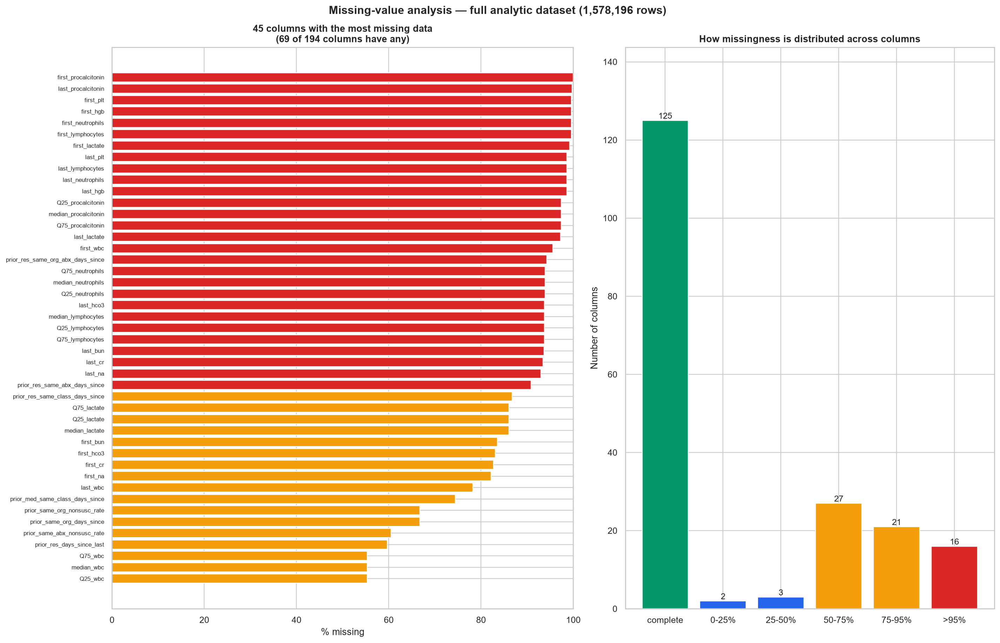

Of **194** columns, **125** are complete, **69** have some missing data, and **16** are more than 95% missing.

| Missingness band | Columns |
|---|--:|
| complete | 125 |
| 0-25% | 2 |
| 25-50% | 3 |
| 50-75% | 27 |
| 75-95% | 21 |
| >95% | 16 |

Worst 15 columns:

| Column | Missing | % |
|---|--:|--:|
| `first_procalcitonin` | 1,577,185 | 99.9359% |
| `last_procalcitonin` | 1,574,398 | 99.7593% |
| `first_plt` | 1,571,818 | 99.5959% |
| `first_hgb` | 1,571,818 | 99.5959% |
| `first_neutrophils` | 1,571,818 | 99.5959% |
| `first_lymphocytes` | 1,571,818 | 99.5959% |
| `first_lactate` | 1,565,840 | 99.2171% |
| `last_plt` | 1,555,735 | 98.5768% |
| `last_lymphocytes` | 1,555,735 | 98.5768% |
| `last_neutrophils` | 1,555,735 | 98.5768% |
| `last_hgb` | 1,555,735 | 98.5768% |
| `Q25_procalcitonin` | 1,537,375 | 97.4134% |
| `median_procalcitonin` | 1,537,375 | 97.4134% |
| `Q75_procalcitonin` | 1,537,375 | 97.4134% |
| `last_lactate` | 1,533,906 | 97.1936% |

> Missingness here is structural, not random. Laboratory columns are missing when the test was not ordered; `*_days_since` columns are missing when the event never happened. Both are informative, so the tree models receive NaN directly rather than an imputed value.

Full table: `tables/02_missing_values.csv`.

## 5. Target distribution

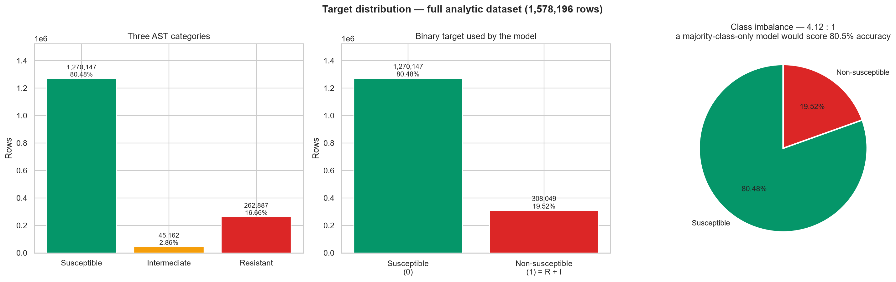

| Category | Rows | Share |
|---|--:|--:|
| Susceptible | 1,270,147 | 80.48% |
| Intermediate | 45,162 | 2.86% |
| Resistant | 262,887 | 16.66% |

Collapsed to the binary target the model uses:

| Class | Rows | Share |
|---|--:|--:|
| Susceptible (0) | 1,270,147 | 80.48% |
| Non-susceptible (1) = Resistant + Intermediate | 308,049 | 19.52% |

**Class imbalance: 4.1232 : 1.** Positive rate is 19.52% on the full dataset and 19.50% on the training partition — the grouped split did not distort the balance.

> Imbalanced but not extremely so. The consequence for evaluation is that accuracy is nearly uninformative (80.5% for a model that always says susceptible), which is why PR-AUC is the selection metric.

## 6. Antibiotic distribution

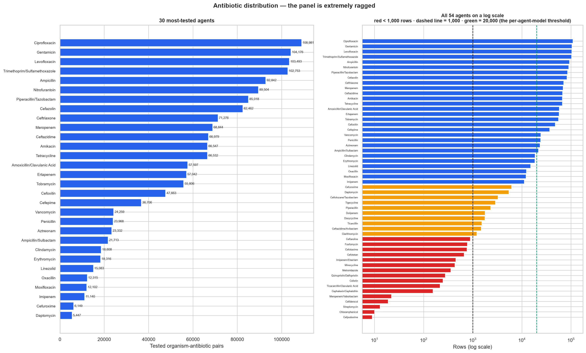

**54 agents** across **23 classes**. The panel is extremely ragged.

| Most tested | Rows | | Least tested | Rows |
|---|--:|---|---|--:|
| `Ciprofloxacin` | 108,981 | | `Metronidazole` | 357 |
| `Gentamicin` | 104,176 | | `Quinupristin/Dalfopristin` | 275 |
| `Levofloxacin` | 103,493 | | `Colistin` | 248 |
| `Trimethoprim/Sulfamethoxazole` | 102,753 | | `Ticacarcillin/Clavulanic Acid` | 216 |
| `Ampicillin` | 92,842 | | `Cephalexin/Cephalothin` | 155 |
| `Nitrofurantoin` | 89,504 | | `Meropenem/Vaborbactam` | 22 |
| `Piperacillin/Tazobactam` | 85,018 | | `Cefiderocol` | 19 |
| `Cefazolin` | 82,462 | | `Streptomycin` | 13 |
| `Ceftriaxone` | 71,276 | | `Chloramphenicol` | 10 |
| `Meropenem` | 68,844 | | `Cefpodoxime` | 9 |

- Agents with fewer than 1,000 rows: **16 of 54**
- Agents with fewer than 100 rows: **5**
- Ratio of most-tested to least-tested: **12,109 : 1**

### Why a unified model rather than one model per antibiotic

> The most-tested agent has 108,981 rows and the least-tested has 9. 16 of 54 agents have fewer than 1,000 rows and 5 have fewer than 100. A separate model per antibiotic is therefore untrainable for most of the panel, and a multi-label target would be ~76% missing by construction because each isolate is only tested against the agents the laboratory selected. A single unified model with the antibiotic and its class as input features uses every row and lets a rare agent inherit structure from its class — which is the only way to score an agent the laboratory did not test.

This EDA finding is what drove the architecture decision in `docs/ML_PROBLEM_DEFINITION.md` §4, and the decision is tested empirically in `docs/MODEL_EVALUATION.md` §11.

Full table: `tables/05_antibiotic_distribution.csv`.

## 7. Organism distribution

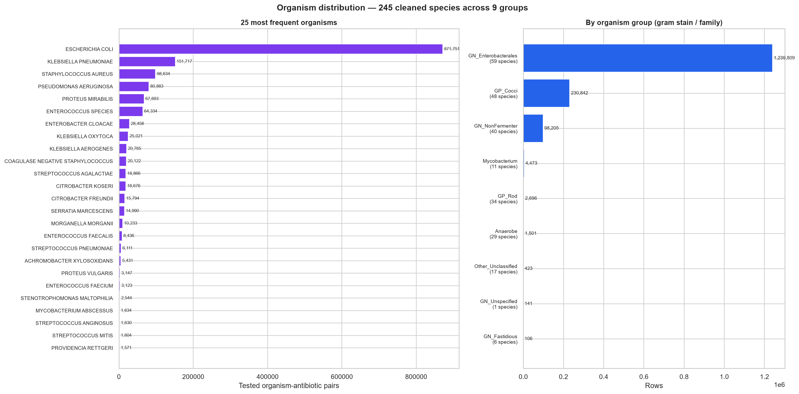

**245 cleaned species** in **9 groups**. The 5 most common species account for **80.515%** of all rows; **142** species have fewer than 100 rows.

| Organism | Rows |
|---|--:|
| ESCHERICHIA COLI | 871,751 |
| KLEBSIELLA PNEUMONIAE | 151,717 |
| STAPHYLOCOCCUS AUREUS | 98,634 |
| PSEUDOMONAS AERUGINOSA | 80,883 |
| PROTEUS MIRABILIS | 67,693 |
| ENTEROCOCCUS SPECIES | 64,334 |
| ENTEROBACTER CLOACAE | 28,458 |
| KLEBSIELLA OXYTOCA | 25,021 |
| KLEBSIELLA AEROGENES | 20,765 |
| COAGULASE NEGATIVE STAPHYLOCOCCUS | 20,122 |

### By organism group

| Group | Rows | Species | Non-susceptibility rate (train) |
|---|--:|--:|--:|
| GN_Enterobacterales | 1,239,809 | 59 | 17.73% |
| GP_Cocci | 230,842 | 48 | 25.28% |
| GN_NonFermenter | 98,205 | 40 | 26.25% |
| Mycobacterium | 4,473 | 11 | 49.61% |
| GP_Rod | 2,696 | 34 | 38.59% |
| Anaerobe | 1,501 | 29 | 13.29% |
| Other_Unclassified | 423 | 17 | 32.90% |
| GN_Unspecified | 141 | 1 | 15.00% |
| GN_Fastidious | 106 | 6 | 24.07% |

> The cohort is dominated by a handful of species: the five most common account for 80.5% of all rows, with Escherichia coli alone the largest by a wide margin. 142 species have fewer than 100 rows. This is why `organism_group` is carried alongside `organism_clean`: a rare species can still be scored through its group's intrinsic-resistance structure.

## 8. Specimen distribution

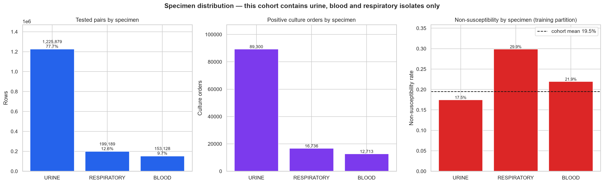

| Specimen | Rows | Culture orders | Patients | Non-susceptibility rate (train) |
|---|--:|--:|--:|--:|
| URINE | 1,225,879 | 89,300 | 53,095 | 17.47% |
| RESPIRATORY | 199,189 | 16,736 | 7,004 | 29.88% |
| BLOOD | 153,128 | 12,713 | 10,065 | 21.94% |

> Only three specimen types exist in this dataset. There are no wound, tissue, CSF, stool or device isolates, so the model must not be applied to them. Urine dominates, which shapes which organisms and agents the model has seen most.

## 9. Patient and demographic analysis

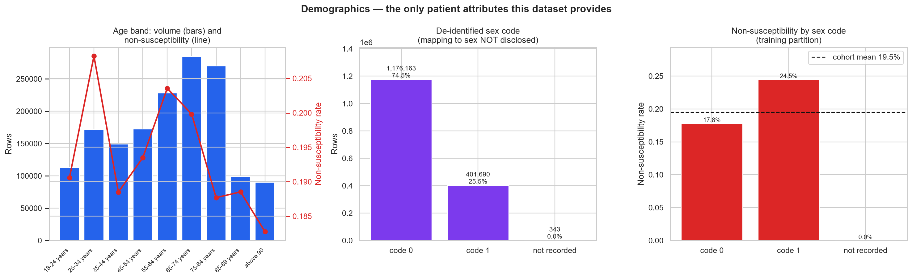

> The dataset provides exactly two patient attributes: a nine-level age BAND (no exact age) and a binary sex code. The source supplies no legend for the sex code, so its mapping to sex is unknown and is never asserted anywhere in this project. There is no weight, height, ethnicity, comorbidity, severity score or admission diagnosis. The youngest band is 18-24 years, so the cohort is adults only and the model must not be used in paediatrics.

### Age bands

| Age band | Rows | Patients | Non-susceptibility rate (train) |
|---|--:|--:|--:|
| 18-24 years | 112,946 | 5,863 | 19.06% |
| 25-34 years | 171,703 | 8,375 | 20.82% |
| 35-44 years | 148,948 | 7,416 | 18.85% |
| 45-54 years | 172,480 | 8,425 | 19.35% |
| 55-64 years | 228,441 | 10,817 | 20.36% |
| 65-74 years | 284,779 | 12,852 | 19.98% |
| 75-84 years | 269,927 | 11,107 | 18.77% |
| 85-89 years | 99,030 | 4,383 | 18.85% |
| above 90 | 89,942 | 3,551 | 18.27% |

### De-identified sex code

| Code | Rows | Non-susceptibility rate (train) |
|---|--:|--:|
| code 0 | 1,176,163 | 17.80% |
| code 1 | 401,690 | 24.48% |
| not recorded | 343 | — |

> **Interpretation warning.** Differences in non-susceptibility across these groups are descriptive associations in one health system. They are confounded by which specimens are collected from whom, which organisms those specimens grow, and which agents the laboratory then tests. No causal or biological claim is made from them.

## 10. Previous antibiotic exposure

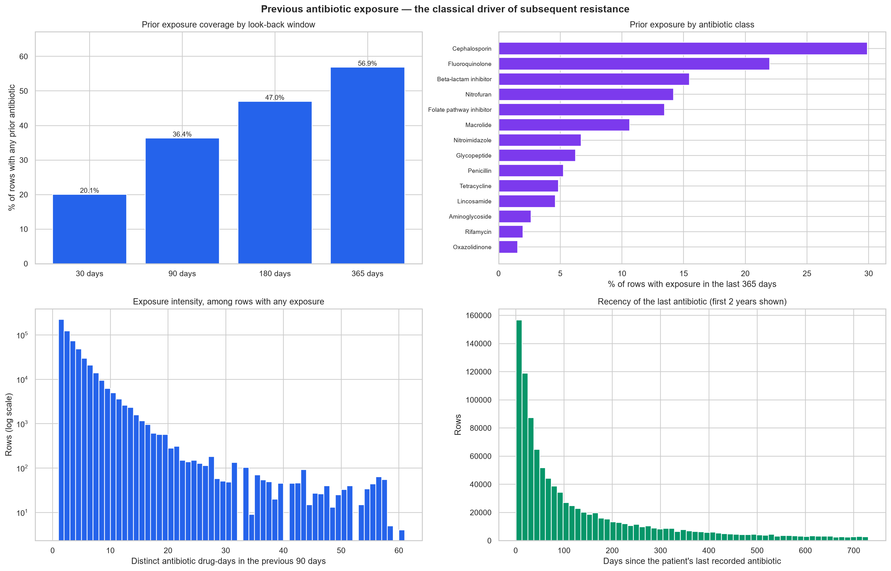

| Look-back window | Rows with any exposure | Mean drug-days when exposed | Median |
|---|--:|--:|--:|
| 30 days | 20.083% | 2.01 | 1.0 |
| 90 days | 36.371% | 3.003 | 2.0 |
| 180 days | 46.99% | 3.982 | 2.0 |
| 365 days | 56.874% | 5.417 | 3.0 |

A prior-medication record exists for **72.633%** of rows.

### Exposure by antibiotic class (365-day window)

| Antibiotic class | Rows exposed | % of rows |
|---|--:|--:|
| Cephalosporin | 471,791 | 29.8943% |
| Fluoroquinolone | 346,902 | 21.9809% |
| Beta-lactam inhibitor | 244,080 | 15.4658% |
| Nitrofuran | 223,800 | 14.1807% |
| Folate pathway inhibitor | 212,171 | 13.4439% |
| Macrolide | 167,697 | 10.6259% |
| Nitroimidazole | 105,638 | 6.6936% |
| Glycopeptide | 98,594 | 6.2473% |
| Penicillin | 82,826 | 5.2481% |
| Tetracycline | 76,460 | 4.8448% |
| Lincosamide | 72,518 | 4.595% |
| Aminoglycoside | 41,593 | 2.6355% |

> Coverage is partial by construction: a prior-medication record exists for 72.6% of rows, and care delivered outside this health system is invisible. Absence of a record is therefore not evidence of absence of exposure, and the model carries an explicit `has_prior_med_history` indicator so it can distinguish 'no exposure' from 'no data'.

## 11. Previous resistance history

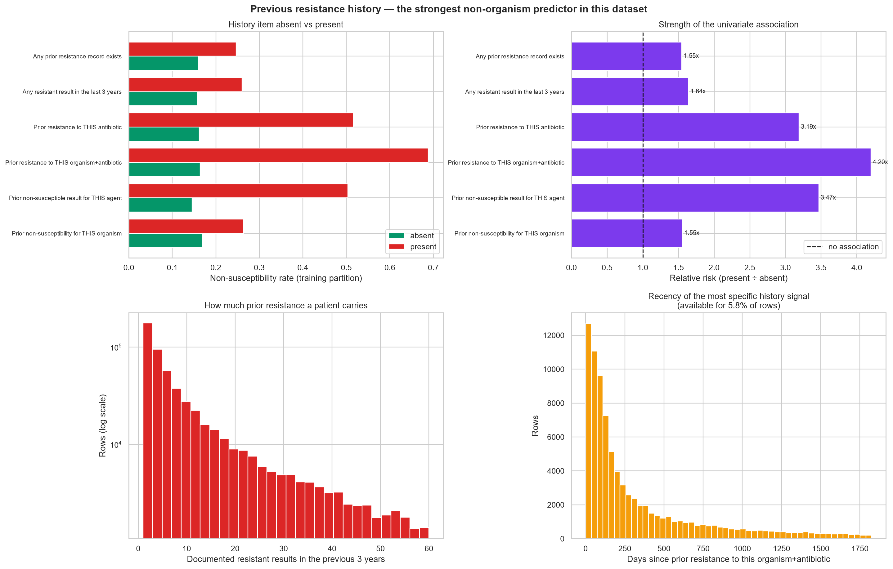

Univariate association with the outcome, computed on the training partition **before any model was fitted**:

| History item | % of rows present | Non-susc. rate when ABSENT | when PRESENT | Relative risk |
|---|--:|--:|--:|--:|
| Any prior resistance record exists | 40.327% | 15.95% | 24.67% | **1.5468×** |
| Any resistant result in the last 3 years | 35.37% | 15.86% | 26.05% | **1.6422×** |
| Prior resistance to THIS antibiotic | 9.195% | 16.18% | 51.62% | **3.1898×** |
| Prior resistance to THIS organism+antibiotic | 5.76% | 16.40% | 68.84% | **4.198×** |
| Prior non-susceptible result for THIS agent | 13.636% | 14.51% | 50.32% | **3.4672×** |
| Prior non-susceptibility for THIS organism | 26.529% | 16.97% | 26.37% | **1.5542×** |

A prior-resistance record exists for **40.327%** of rows.

> These are univariate associations computed before any model was fitted, which matters: it shows the signal the model later exploits is present in the data rather than manufactured by the learner. The most specific feature — prior resistance to this exact organism-antibiotic pair — carries the largest relative risk but is available for only a small minority of rows.

## 12. Temporal trends

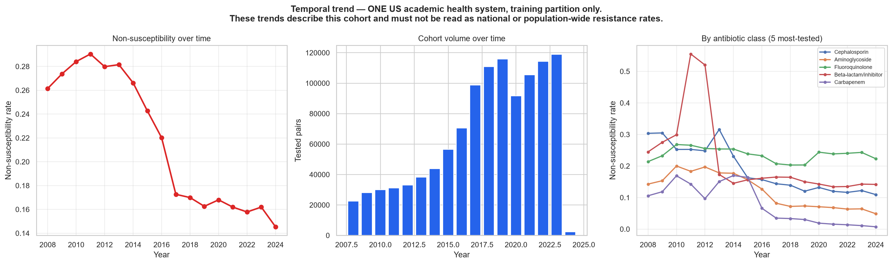

Across **2008–2024** the measured non-susceptibility rate in this cohort fell from **26.15%** to **14.54%** (-0.1161 absolute), peaking at **29.05%** in 2011.

| Year | Rows | Culture orders | Non-susceptibility rate |
|--:|--:|--:|--:|
| 2008 | 22,505 | 2,455 | 26.15% |
| 2009 | 28,077 | 3,089 | 27.38% |
| 2010 | 29,923 | 3,265 | 28.41% |
| 2011 | 31,098 | 3,510 | 29.05% |
| 2012 | 33,092 | 3,612 | 27.98% |
| 2013 | 38,202 | 3,929 | 28.15% |
| 2014 | 43,743 | 4,245 | 26.62% |
| 2015 | 56,452 | 5,199 | 24.27% |
| 2016 | 70,520 | 5,721 | 22.02% |
| 2017 | 98,836 | 6,163 | 17.27% |
| 2018 | 110,840 | 7,198 | 16.99% |
| 2019 | 115,928 | 7,505 | 16.26% |
| 2020 | 91,653 | 5,958 | 16.80% |
| 2021 | 105,407 | 6,825 | 16.19% |
| 2022 | 114,314 | 7,250 | 15.78% |
| 2023 | 118,913 | 7,505 | 16.20% |
| 2024 | 2,290 | 146 | 14.54% |

> **Scope warning.** This dataset is a single US academic health system. The trend describes THIS cohort's tested isolates. It is not a national resistance rate, not a population prevalence, and not generalisable to other institutions. It is also shaped by changes in which agents the laboratory chose to test and by breakpoint revisions during the period.

A falling measured rate does **not** establish that resistance is declining. It is equally consistent with a change in which isolates get an AST panel, a shift in case-mix towards lower-risk outpatient urines, or breakpoint revisions. This analysis cannot separate those explanations and does not attempt to.

> A visible drift is the justification for reporting a temporal holdout alongside the random patient split: a model fitted on earlier years faces a shifted distribution in later ones.

## 13. Antibiotic–organism patterns

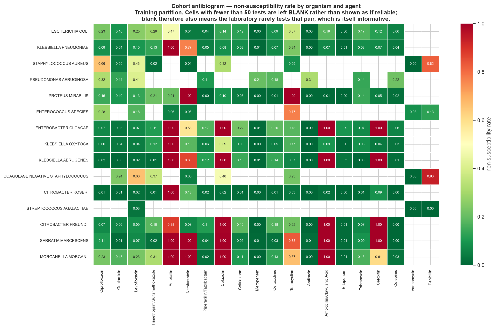

Cells with fewer than **50** tests are left blank rather than displayed as though reliable. Of the displayed block, 72.0% of cells clear that bar.

### Sparsity of the full organism × antibiotic space

| Measure | Value |
|---|--:|
| Possible organism × antibiotic combinations | 12,582 |
| Combinations with **any** test | 2,721 (21.626%) |
| Combinations with ≥50 tests | 514 (4.085%) |

> Only 21.6% of the full organism x antibiotic space has ANY test at all, and only 4.1% has 50 or more. This is panel-selection bias made visible, and it is the central reason a unified model that shares structure through antibiotic class and organism group was chosen over independent per-agent models.

### This figure also validates the cleaning pipeline

> This figure independently validates the cleaning pipeline. Textbook intrinsic resistance appears at or near 1.00 exactly where microbiology says it should: Klebsiella with ampicillin, Proteus with nitrofurantoin and tetracycline, the AmpC organisms (Enterobacter, Citrobacter freundii, Klebsiella aerogenes) with cefazolin, cefoxitin and amoxicillin-clavulanate, Serratia with nitrofurantoin, and Staphylococcus aureus with penicillin. If labels or organism names had been mishandled, these patterns would not survive.

## 13b. Feature distributions

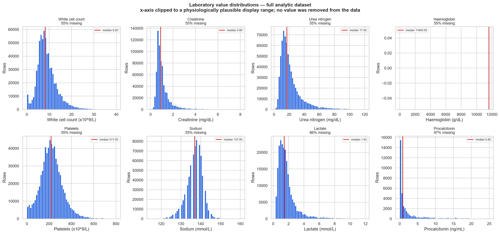

| Analyte | Unit | % missing | Median | IQR | 1st–99th pct |
|---|---|--:|--:|--:|--:|
| White cell count | x10^9/L | 55.301% | 8.2 | 6.1 – 11.1 | 0.4 – 27.8 |
| Creatinine | mg/dL | 54.784% | 0.89 | 0.69 – 1.23 | 0.35 – 6.14 |
| Urea nitrogen | mg/dL | 55.173% | 17 | 12 – 26 | 5 – 90 |
| Haemoglobin | g/dL | 55.219% | 11600 | 9800 – 13000 | 6900 – 15800 |
| Platelets | x10^9/L | 55.283% | 217 | 158 – 279 | 15 – 538 |
| Sodium | mmol/L | 55.023% | 137 | 135 – 140 | 125 – 147 |
| Lactate | mmol/L | 86.06% | 1.43 | 0.97 – 2.07 | 0.4 – 8.9 |
| Procalcitonin | ng/mL | 97.413% | 0.82 | 0.21 – 4.32 | 0.03 – 159.78 |

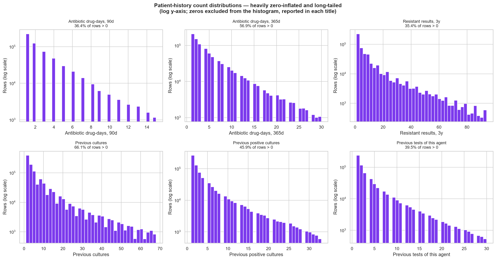

| History feature | % of rows = 0 | Median when > 0 | Max |
|---|--:|--:|--:|
| Antibiotic drug-days, 90d | 63.629% | 2.0 | 78 |
| Antibiotic drug-days, 365d | 43.126% | 3.0 | 192 |
| Resistant results, 3y | 64.63% | 5.0 | 396 |
| Previous cultures | 33.908% | 4.0 | 157 |
| Previous positive cultures | 54.088% | 2.0 | 94 |
| Previous tests of this agent | 60.526% | 2.0 | 117 |

> The laboratory values are right-skewed with long tails, which is expected for inflammatory and renal markers in an infected population. The history counts are heavily zero-inflated: for most rows the patient has no recorded prior event at all. Neither shape is a problem for gradient-boosted trees, which split on rank rather than magnitude — which is also why no log transform or scaling was applied for the tree models.

## 14. Correlation analysis

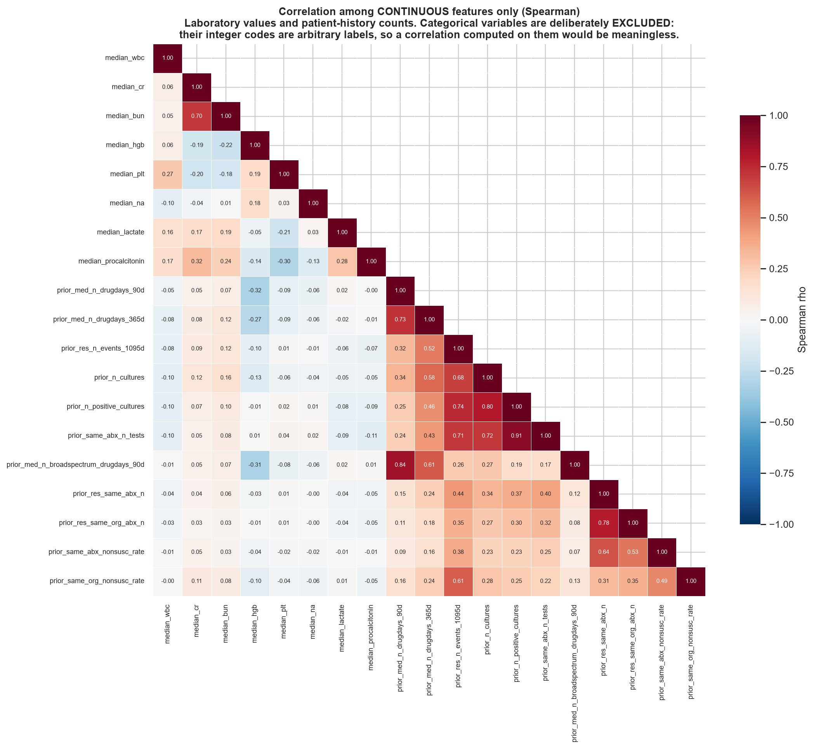

> **Which variables were included, and why.** Correlation is only meaningful between variables with a genuine ordering. The continuous laboratory values and the ordered patient-history counts qualify. The nine categorical features (organism, antibiotic, class, specimen, morphotype and so on) do NOT: their integer codes are arbitrary labels assigned by the encoder, so a Pearson or Spearman coefficient computed on them would be an artefact of the encoding order and is not reported. Spearman rather than Pearson because every one of these features is skewed or zero-inflated.

13 pairs exceed |ρ| = 0.6. The strongest:

| Feature A | Feature B | Spearman ρ |
|---|---|--:|
| `prior_same_abx_n_tests` | `prior_n_positive_cultures` | +0.906 |
| `prior_med_n_broadspectrum_drugdays_90d` | `prior_med_n_drugdays_90d` | +0.844 |
| `prior_n_positive_cultures` | `prior_n_cultures` | +0.802 |
| `prior_res_same_org_abx_n` | `prior_res_same_abx_n` | +0.785 |
| `prior_n_positive_cultures` | `prior_res_n_events_1095d` | +0.745 |
| `prior_med_n_drugdays_365d` | `prior_med_n_drugdays_90d` | +0.726 |
| `prior_same_abx_n_tests` | `prior_n_cultures` | +0.718 |
| `prior_same_abx_n_tests` | `prior_res_n_events_1095d` | +0.709 |
| `median_bun` | `median_cr` | +0.705 |
| `prior_n_cultures` | `prior_res_n_events_1095d` | +0.680 |

> The redundancy visible here is what the feature-selection correlation filter acted on: 35 features were removed at |rho| > 0.95. The moderately-correlated pairs that remain are the reason a single SHAP attribution within a correlated group should not be read in isolation — see the XAI report.

## 15. Outlier analysis

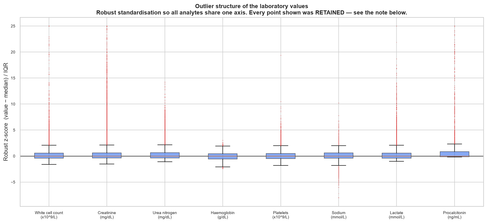

**Method.** Tukey IQR fences (Q1 - 1.5xIQR, Q3 + 1.5xIQR) for the statistical tail, plus an explicit per-analyte physiological range check for data-entry artefacts.

| Analyte | IQR outliers | % | Max observed | Plausible range | Impossible values |
|---|--:|--:|--:|---|--:|
| White cell count | 30,155 | 4.2747% | 485.2 | 0 - 500 | 0 |
| Creatinine | 63,088 | 8.8409% | 24 | 0 - 30 | 0 |
| Urea nitrogen | 51,000 | 7.2089% | 216 | 0 - 300 | 0 |
| Haemoglobin | 587 | 0.0831% | 21300 | 1000 - 30000 | 0 |
| Platelets | 16,212 | 2.2972% | 2561 | 0 - 3000 | 0 |
| Sodium | 25,214 | 3.5521% | 188 | 90 - 200 | 0 |
| Lactate | 15,791 | 7.178% | 29.3 | 0 - 40 | 0 |
| Procalcitonin | 6,394 | 15.6635% | 713 | 0 - 1000 | 0 |

**Action taken: RETAINED — nothing was removed, transformed or capped.**

> Two separate populations sit in these tails and they were treated differently in the reporting, not in the data.

(1) STATISTICAL OUTLIERS — values beyond the IQR fences but physiologically real. In an infected inpatient population these are the clinical signal, not noise: a creatinine of 8 mg/dL or a lactate of 12 mmol/L identifies exactly the severely unwell patients whose resistance risk differs most. Trimming them would delete the informative tail, so they are kept.

(2) PHYSIOLOGICALLY IMPOSSIBLE VALUES — checked explicitly against a per-analyte range. 0 values across 0 analyte(s) fall outside any possible human range.

One finding is worth recording because it nearly produced a false alarm. The `*_hgb` columns are exported in **mg/dL, not g/dL**: the median is 11,600 and the 1st-99th percentile span is 6,900-15,800, i.e. 11.6 g/dL and 6.9-15.8 g/dL. Bounded on a g/dL scale, every one of the 706,738 haemoglobin values would have been flagged as impossible. The error was in the analysis assumption, not in the data, and the range check was corrected rather than the data being 'cleaned'. Units in this export are not uniform across analytes and should be confirmed per column before any laboratory feature is used.

> Three reasons, in order of importance. (a) NO laboratory feature survived feature selection, so not one of these values reaches the deployed model — the practical impact on results is exactly zero. (b) The model family is gradient-boosted trees, which split on rank rather than magnitude, so an impossible value sits in the same terminal bin as a merely extreme one and changes nothing. (c) Deleting rows on the basis of one analyte would discard the other, valid measurements on the same row, and imputing them would manufacture data. Reporting the count is the honest option.

If a future version DID use laboratory features, these values would need to be nulled (not the rows dropped) before training. That is recorded as a limitation, not left as a silent assumption.

*The histogram x-axes in figure 11 are clipped to a plausible display range so the bulk of each distribution is visible. That is a plotting choice only; the underlying data is unclipped and every row reaches the pipeline.*

## 16. Important findings

The seven results from this EDA that shaped the rest of the project:

1. **The antibiotic panel is extremely ragged.** 16 of 54 agents have fewer than 1,000 rows and the most-to-least ratio is 12,109:1. A separate model per antibiotic is untrainable for most of the panel.
2. **The organism × antibiotic space is 78% empty.** Only 21.626% of combinations have any test at all. Sharing structure through antibiotic class and organism group is not an optimisation, it is a requirement.
3. **Patient history carries large univariate signal.** Prior resistance to the same organism-antibiotic pair raises the non-susceptibility rate from 16.40% to 68.84% — a 4.198× relative risk — measured before any model was fitted.
4. **Class imbalance is real but moderate** (4.1232:1). Accuracy is nearly uninformative at 80.48% for a majority-class-only model, which is why PR-AUC is the selection metric.
5. **Missingness is structural and informative**, not random: a lab is missing because it was not ordered. Imputing it would destroy the signal, so the tree models receive NaN directly.
6. **The antibiogram reproduces textbook intrinsic resistance** at or near 1.00 — an independent check that the cleaning and labelling are correct.
7. **The source laboratory export contains duplicated columns** — 6 `first_*`/`last_*` columns carry byte-identical values under different analyte names. They were already excluded by the missingness filter, so nothing corrupted reached the model, but the defect is now on record.

## 17. Implications for feature engineering

| EDA finding | What it changed |
|---|---|
| Ragged antibiotic panel | Built `src/preprocessing/antibiotic_taxonomy.py` so every agent carries a class, subclass and WHO AWaRe tier, letting rare agents inherit structure. |
| Sparse organism × antibiotic space | Carried `organism_genus` and `organism_group` alongside the species, so a rare organism is still scoreable. |
| Strong history signal | Invested in time-windowed prior exposure and prior-resistance features at four look-back windows, at order, antibiotic, class and organism-antibiotic granularity. |
| Informative missingness | Kept NaN rather than imputing, and added explicit `has_labs` / `has_prior_med_history` / `has_prior_resistance_history` indicators so the model can tell 'no event' from 'no data'. |
| Long-tailed, zero-inflated counts | No log transform and no scaling for the tree models — they split on rank, so the transform would add nothing. A separate one-hot + impute + standardise pipeline was built for the linear baselines. |
| Duplicated / mis-scaled laboratory columns | Confirmed the missingness filter already excludes them; recorded a warning that any future use of laboratory features must verify units and column identity first. |

## 18. Implications for feature selection

| EDA finding | What it predicted | What selection actually found |
|---|---|---|
| Laboratory block is highly redundant (Q25/median/Q75 of the same analyte) | Many features would be dropped as collinear | 35 features removed at |ρ| > 0.95 |
| Laboratory coverage is partial and the values measure *severity*, not organism-drug biology | Lab features would rank low | **No laboratory feature survived** into the final 30 |
| History features carry large univariate signal | They would rank high | 15 of the final 30 are history features |
| Organism dominates the resistance pattern | Organism features would be essential | Removing them costs 0.11 PR-AUC in the organism-blind ablation |
| Age is confounded with comorbidity and prior exposure | Age would add little once exposure is modelled | `age_band_ordinal` ranked outside the top 30 and was dropped |

The final set is **30 features** (candidate set `C_model_based_XGB_top30`), selected from 185 candidates. Full methodology: [`../04_FEATURE_SELECTION/FEATURE_SELECTION_REPORT.md`](../04_FEATURE_SELECTION/FEATURE_SELECTION_REPORT.md).

## 19. Limitations of this EDA

1. **Single centre, single country.** Every rate here describes one US academic health system's tested isolates. None is a population prevalence or a national resistance rate.
2. **Conditioned on being tested.** Every resistance rate is computed over organism-antibiotic pairs the laboratory chose to test. That choice depends on the organism, the specimen and local protocol, so these are not the rates that would be observed if everything were tested.
3. **Conditioned on a positive culture.** The 630,798 negative cultures carry no susceptibility result and are outside this analysis, except where they contribute to prior-culture counts.
4. **Associations are not causal.** Prior antibiotic exposure predicting resistance is consistent with selection pressure, but also with confounding by comorbidity, healthcare contact and severity. Nothing here separates those.
5. **Three specimen types, adults only.** No wound, tissue, CSF, stool or device isolates; the youngest age band is 18–24.
6. **Demographics are minimal.** A nine-level age band and an unlabelled binary sex code. No weight, ethnicity, comorbidity or severity score exists, so none of the usual confounders can be adjusted for.
7. **Breakpoints changed during the period.** A susceptibility category from 2008 and one from 2023 are not always defined identically, which contributes to the temporal trend by an amount this analysis cannot quantify.
8. **Target-related statistics use the training partition only**, so they are not exactly the full-cohort rates; the difference is small (19.52% vs 19.50% overall) but non-zero.
