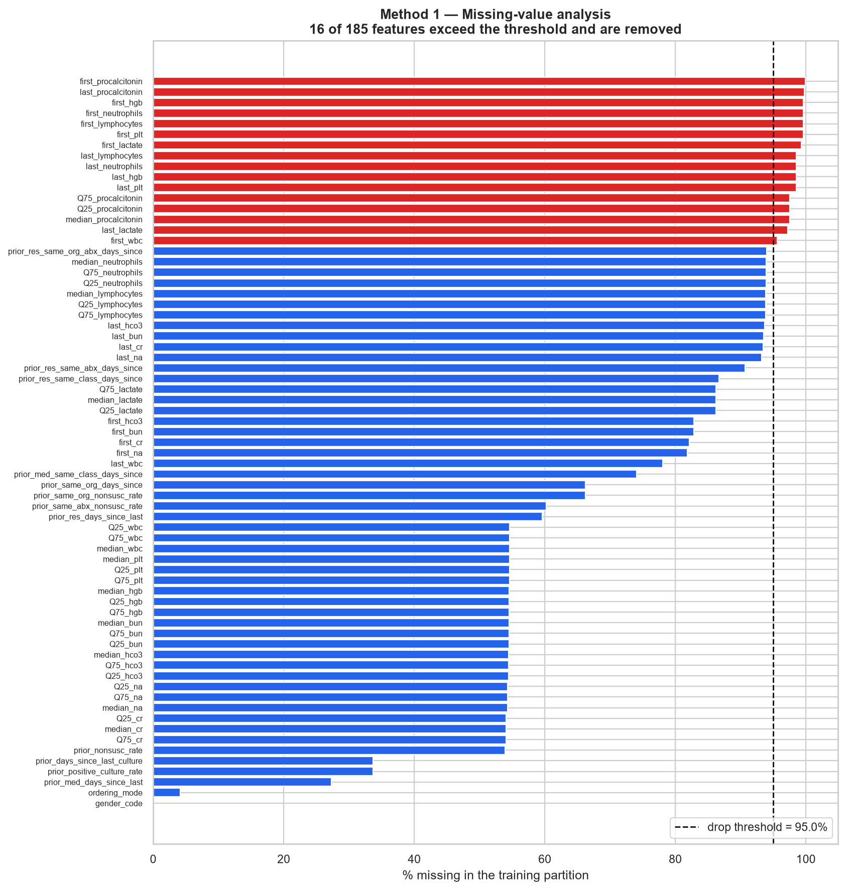
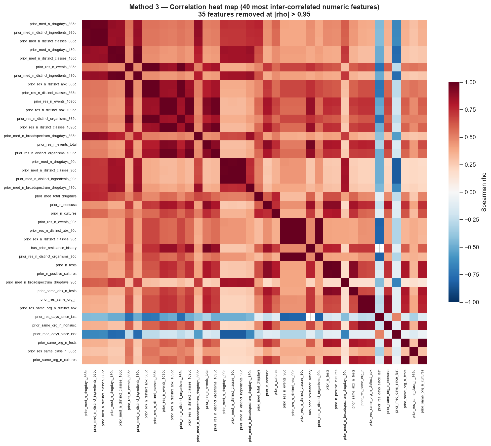
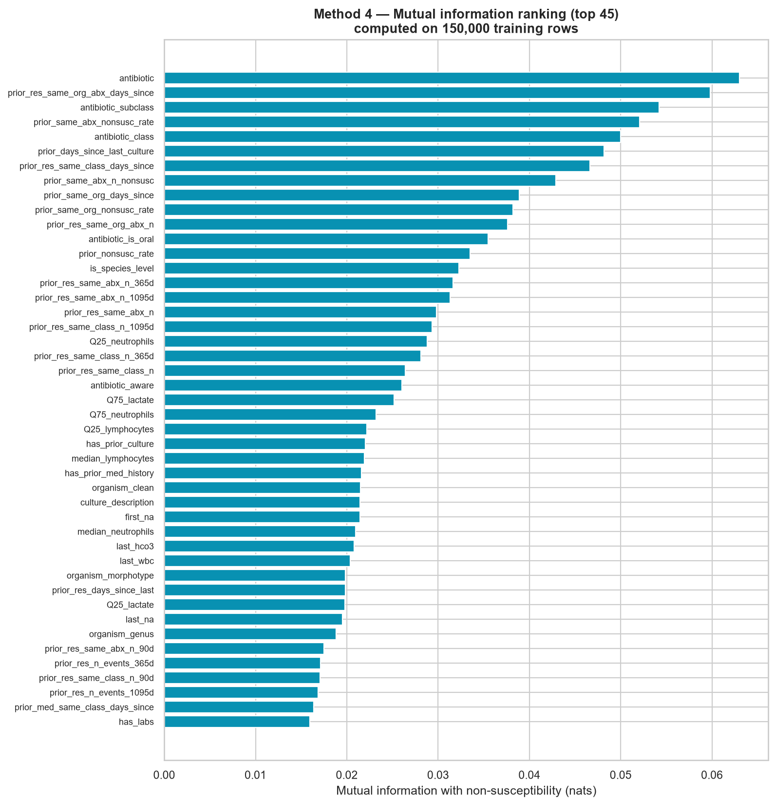
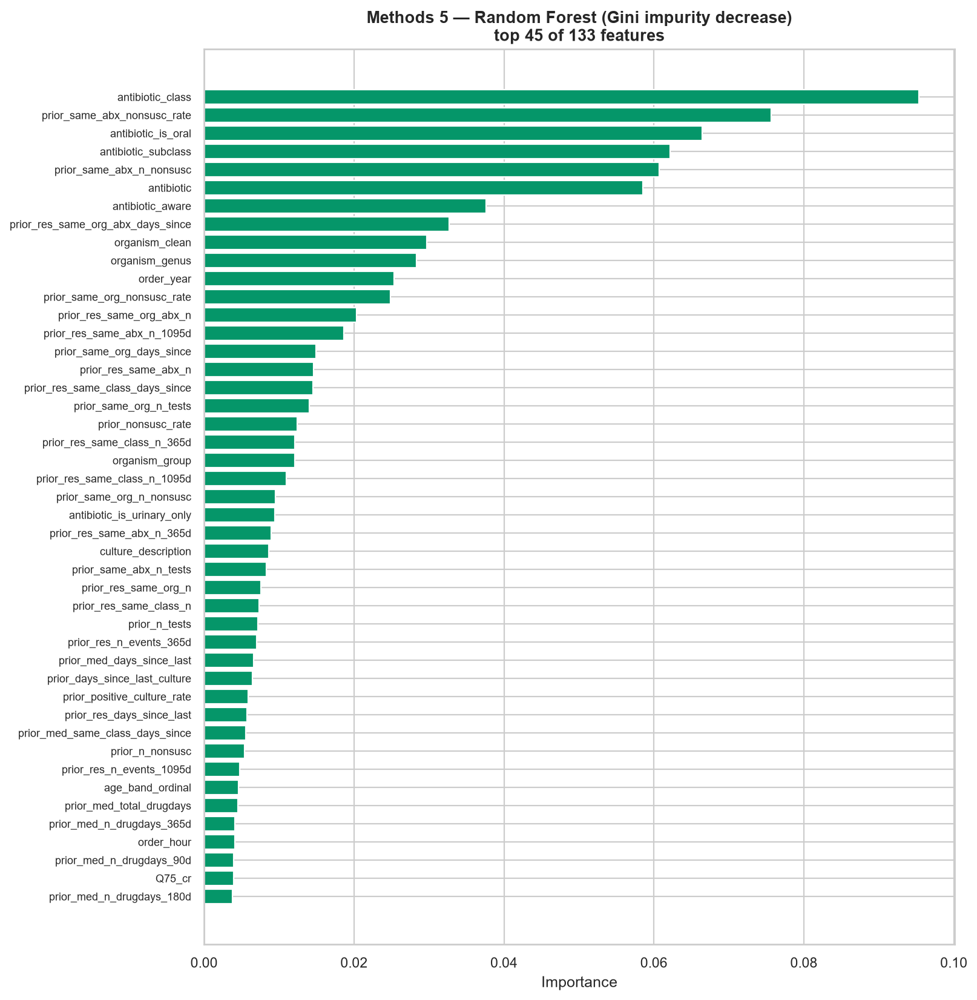
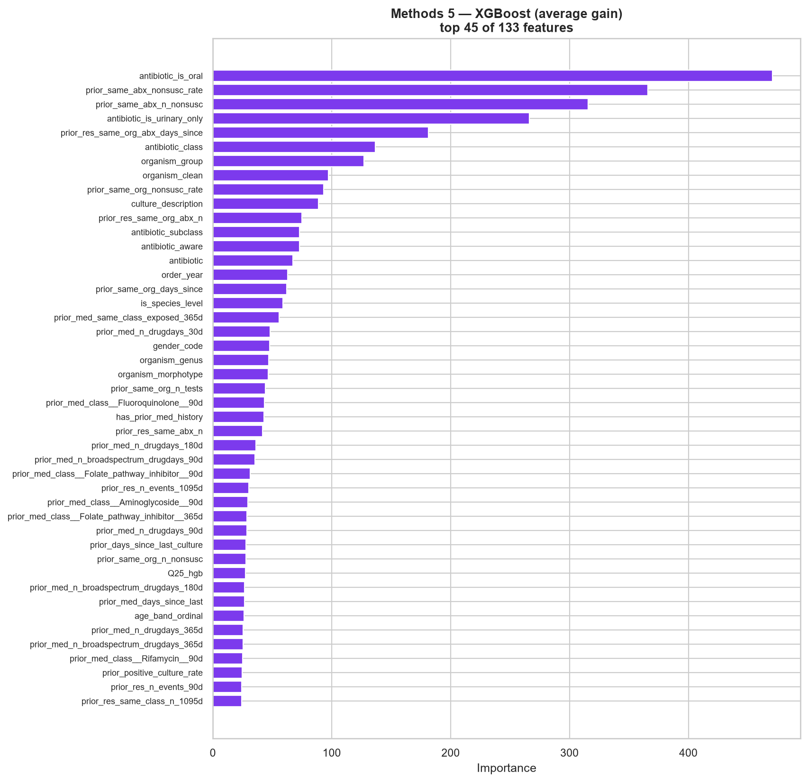
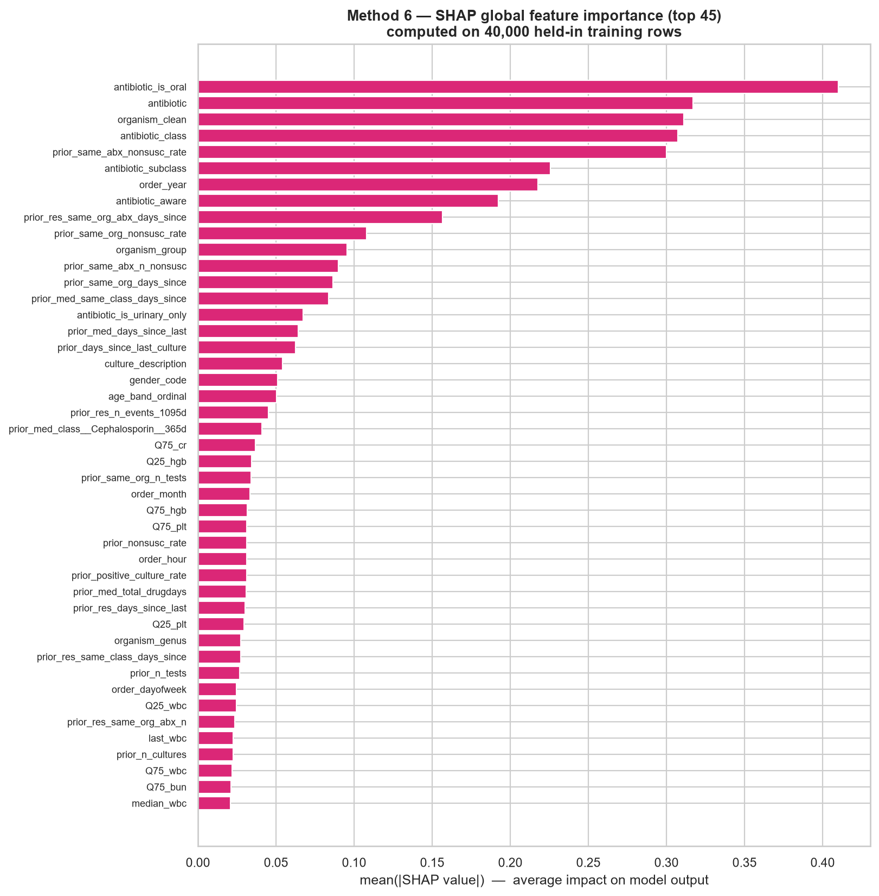
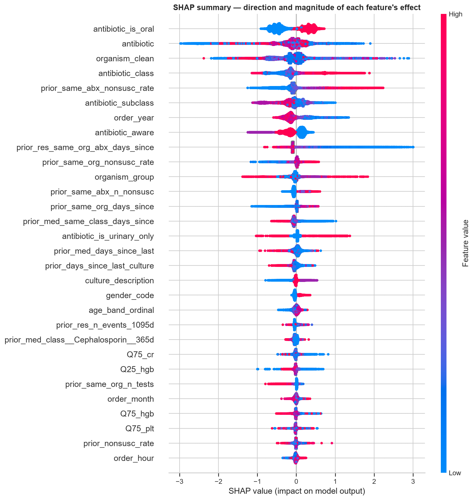
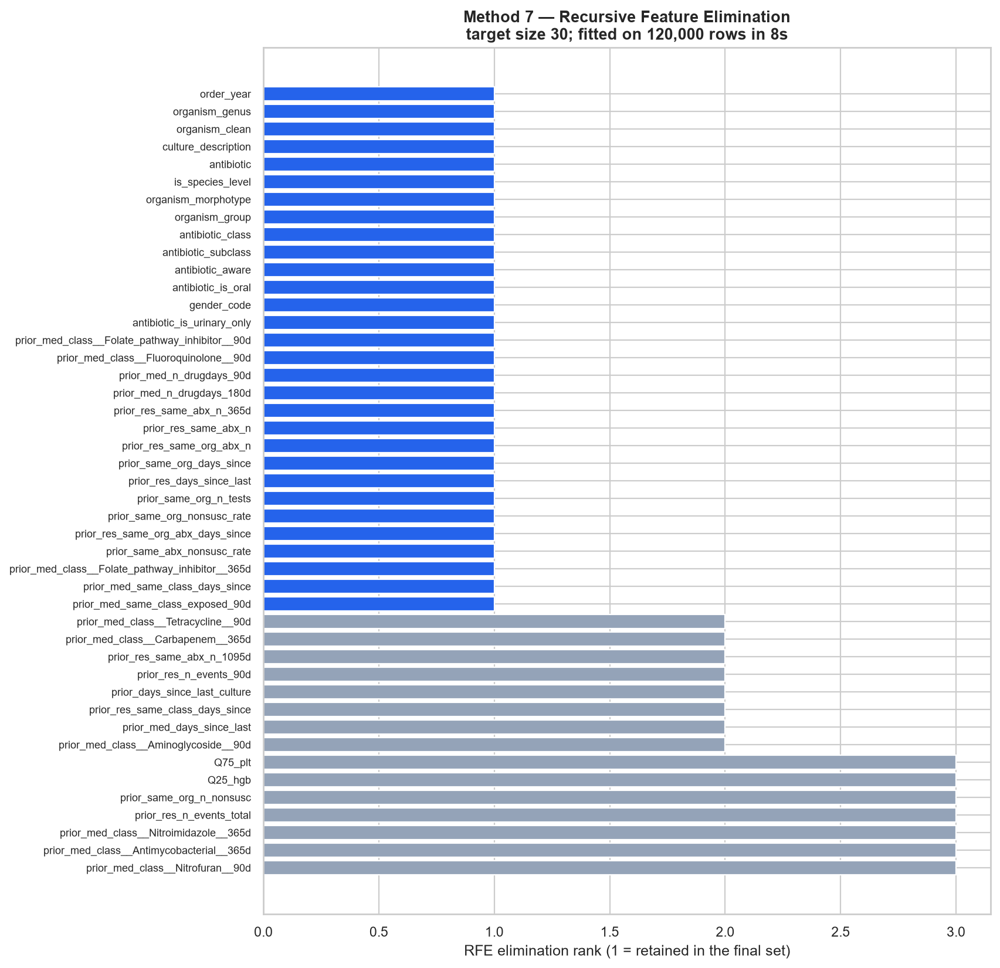
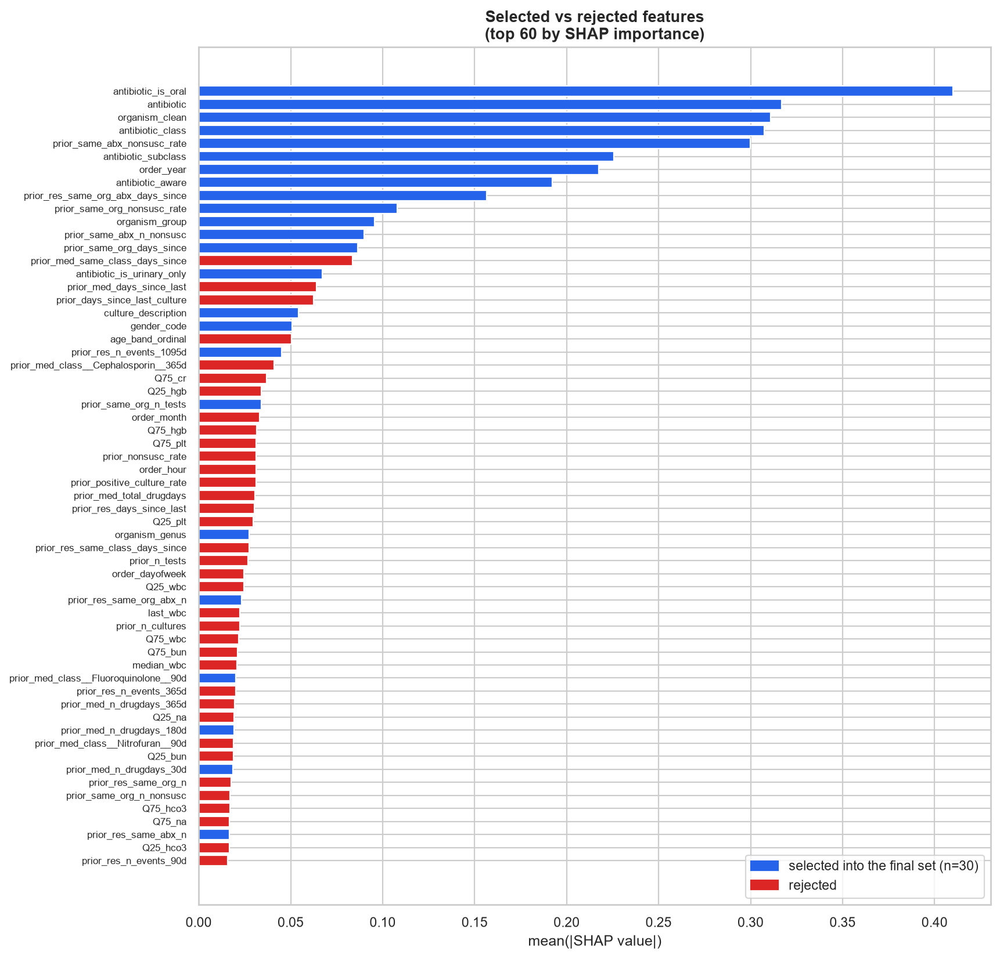
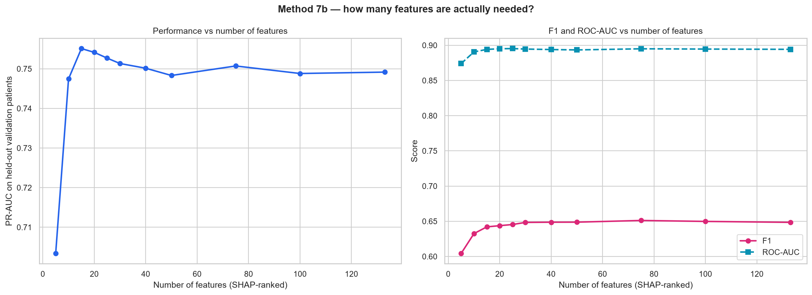

# Feature Selection Report

> Auto-generated by `scripts/10_generate_feature_docs.py` from `04_FEATURE_SELECTION/selected_features/feature_selection_report.json`. Every number was measured on the training partition only.

## 0. Summary

- **Candidate features entering selection:** 185 (10 categorical, 175 numeric)
- **Final feature set:** 30 features (candidate set `C_model_based_XGB_top30`)
- **Validation PR-AUC of the final set:** 0.76146
- **Optimism introduced by selecting on the whole training set:** +0.00102 PR-AUC (nested 0.75861 vs global 0.75963) — negligible
- **Split used:** patient-grouped; 1,111,803 training rows from 46,905 patients, 154,426 validation rows from 6,701 unseen patients. The test partition was never touched.

## 1. Feature inventory before selection

Every modellable column, assigned to one clinical group:

| Group | Features | Examples |
|---|--:|---|
| Patient | 3 | `age_band_ordinal`, `age_midpoint_years`, `gender_code` |
| Context | 6 | `order_year`, `order_month`, `order_dayofweek`, `order_hour` … |
| Microbiology | 5 | `organism_clean`, `organism_genus`, `organism_group`, `organism_morphotype` … |
| Antibiotic | 6 | `antibiotic`, `antibiotic_class`, `antibiotic_subclass`, `antibiotic_aware` … |
| Laboratory | 56 | `Q75_wbc`, `Q25_wbc`, `median_wbc`, `Q25_neutrophils` … |
| Prior Medication | 63 | `prior_med_n_drugdays_30d`, `prior_med_n_distinct_ingredients_30d`, `prior_med_n_distinct_classes_30d`, `prior_med_n_broadspectrum_drugdays_30d` … |
| Prior Resistance | 28 | `prior_res_n_events_90d`, `prior_res_n_distinct_abx_90d`, `prior_res_n_distinct_classes_90d`, `prior_res_n_distinct_organisms_90d` … |
| Prior Culture | 16 | `prior_n_cultures`, `prior_n_positive_cultures`, `prior_n_tests`, `prior_n_nonsusc` … |
| Other | 2 | `has_prior_med_history`, `has_prior_resistance_history` |

## 2. Features excluded before any statistic was computed

| Column | Reason |
|---|---|
| `anon_id` | Patient identifier — memorisable; used only to group the split. |
| `pat_enc_csn_id_coded` | Encounter identifier — no clinical content. |
| `order_proc_id_coded` | Order identifier — used only to link a prediction to its culture. |
| `order_time` | Raw timestamp — replaced by year/month/day-of-week/hour. |
| `susceptibility` | Target (raw label). |
| `severity` | Target (ordinal encoding of the label). |
| `y_nonsusceptible` | Target (binary). |
| `y_3class` | Target (3-class). |
| `age` | Raw age band string — replaced by age_band_ordinal and age_midpoint_years. |

See `docs/DATA_LEAKAGE_ANALYSIS.md` for the evidence behind each exclusion.

## 3. Method 1 — Missing-value analysis

**Threshold: drop above 95.0% missing. 16 of 185 features removed.**

> Gradient-boosted trees treat NaN as a routed branch, so a moderately missing feature is still usable and its missingness is itself informative (an unordered procalcitonin means the clinician did not suspect severe sepsis). The threshold is therefore set high (95%) and removes only features so sparse that any split on them is fitted to a handful of patients.

Removed:

| Feature | % missing |
|---|--:|
| `first_procalcitonin` | 99.924% |
| `last_procalcitonin` | 99.792% |
| `first_hgb` | 99.588% |
| `first_neutrophils` | 99.588% |
| `first_lymphocytes` | 99.588% |
| `first_plt` | 99.588% |
| `first_lactate` | 99.306% |
| `last_lymphocytes` | 98.515% |
| `last_neutrophils` | 98.515% |
| `last_hgb` | 98.515% |
| `last_plt` | 98.515% |
| `Q75_procalcitonin` | 97.491% |
| `Q25_procalcitonin` | 97.491% |
| `median_procalcitonin` | 97.491% |
| `last_lactate` | 97.239% |
| `first_wbc` | 95.572% |

## 4. Method 2 — Low-variance / near-constant filter

**Threshold: drop if one value covers more than 99.9% of non-missing rows. 1 removed.**

> A feature whose single most common value covers >99.9% of rows cannot separate a 19.5% positive class in any useful way; it only adds a split point for the tree to overfit. Note that the audit already removed the two genuinely constant source columns (`Period_Day` = 14, `was_positive` = 1 after filtering) upstream, so this filter is a safety net rather than the main event.

| Feature | Dominant value share | Distinct values |
|---|--:|--:|
| `prior_med_class__Monobactam__90d` | 0.99907 | 4 |

## 5. Method 3 — Correlation analysis

**Threshold: |Spearman rho| > 0.95. 57 pairs exceeded it; 35 features removed.**

> The lab block is highly redundant by construction — Q25/median/Q75 of the same analyte over the same 14-day window are near-identical, and so are the class-level prior-exposure counts at 90d and 365d. Spearman is used rather than Pearson because most of these features are skewed counts. Removing one of each redundant pair shortens training and makes the SHAP attributions readable, since perfectly collinear features split their credit arbitrarily.

Most-correlated pairs (top 15):

| Feature A | Feature B | \|rho\| |
|---|---|--:|
| `age_band_ordinal` | `age_midpoint_years` | 1.0000 |
| `prior_med_n_distinct_ingredients_30d` | `prior_med_n_distinct_classes_30d` | 0.9996 |
| `prior_res_n_distinct_abx_90d` | `prior_res_n_distinct_classes_90d` | 0.9996 |
| `prior_res_n_events_90d` | `prior_res_n_distinct_abx_90d` | 0.9995 |
| `prior_res_n_events_90d` | `prior_res_n_distinct_classes_90d` | 0.9991 |
| `prior_res_n_distinct_abx_365d` | `prior_res_n_distinct_classes_365d` | 0.9983 |
| `prior_med_n_distinct_ingredients_90d` | `prior_med_n_distinct_classes_90d` | 0.9982 |
| `prior_med_n_drugdays_30d` | `prior_med_n_distinct_ingredients_30d` | 0.9979 |
| `prior_med_n_drugdays_30d` | `prior_med_n_distinct_classes_30d` | 0.9976 |
| `prior_res_n_distinct_abx_1095d` | `prior_res_n_distinct_classes_1095d` | 0.9970 |
| `prior_res_n_distinct_classes_90d` | `prior_res_n_distinct_organisms_90d` | 0.9970 |
| `prior_res_n_events_90d` | `prior_res_n_distinct_organisms_90d` | 0.9970 |
| `prior_res_n_distinct_abx_90d` | `prior_res_n_distinct_organisms_90d` | 0.9969 |
| `prior_res_n_events_365d` | `prior_res_n_distinct_abx_365d` | 0.9968 |
| `prior_med_n_distinct_ingredients_180d` | `prior_med_n_distinct_classes_180d` | 0.9965 |

## 6. Method 4 — Statistical selection (ANOVA F + mutual information)

> ANOVA F tests a linear mean shift and mutual information captures any monotone or non-monotone dependence, so they are complementary and disagree in informative ways. Chi-square was NOT used: it requires non-negative discrete counts, and the ordinal-coded categoricals and z-scored labs here violate that assumption, so it would return a number without meaning.

6 features failed to reach p < 0.05 on the ANOVA F test; 8 had zero estimated mutual information with the target.

Top 15 by mutual information:

| Feature | Mutual information | ANOVA F |
|---|--:|--:|
| `antibiotic` | 0.06301 | — |
| `prior_res_same_org_abx_days_since` | 0.059803 | — |
| `antibiotic_subclass` | 0.054199 | — |
| `prior_same_abx_nonsusc_rate` | 0.052086 | 62248.489 |
| `antibiotic_class` | 0.049967 | 24030.251 |
| `prior_days_since_last_culture` | 0.048157 | — |
| `prior_res_same_class_days_since` | 0.046601 | — |
| `prior_same_abx_n_nonsusc` | 0.042877 | 20130.462 |
| `prior_same_org_days_since` | 0.038872 | — |
| `prior_same_org_nonsusc_rate` | 0.038216 | 24826.326 |
| `prior_res_same_org_abx_n` | 0.037625 | 17199.403 |
| `antibiotic_is_oral` | 0.035485 | 21475.397 |
| `prior_nonsusc_rate` | 0.03351 | 19017.498 |
| `is_species_level` | 0.032278 | — |
| `prior_res_same_abx_n_365d` | 0.031638 | 23618.96 |

## 7. Methods 5 and 6 — Model-based and SHAP importance

> Random Forest impurity importance is biased towards high-cardinality features, and `organism_clean` has 245 levels, so it is reported but not trusted alone. XGBoost average gain is the counterweight, and SHAP (Method 6) is the arbiter because it is the only one of the three that is additive and locally faithful.

> SHAP is the selection arbiter because its attributions are additive and locally faithful, so a feature that only matters for a small but clinically important subgroup is not averaged away as it is by gain. It is also the same machinery the application uses to explain an individual prediction, so what selects a feature and what explains it to a clinician are consistent.

Random Forest fitted in 43.83s, XGBoost in 13.1s; SHAP computed on 40,000 rows. 1 features received zero gain from XGBoost — the model never split on them at all.

Top 15, three rankers side by side:

| Feature | SHAP mean\|value\| | XGBoost gain | Random Forest |
|---|--:|--:|--:|
| `antibiotic_is_oral` | 0.410042 | 470.7625 | 0.06644 |
| `antibiotic` | 0.316812 | 67.4264 | 0.058525 |
| `organism_clean` | 0.310909 | 97.0581 | 0.029716 |
| `antibiotic_class` | 0.307316 | 136.498 | 0.095346 |
| `prior_same_abx_nonsusc_rate` | 0.299832 | 365.8004 | 0.075605 |
| `antibiotic_subclass` | 0.225708 | 72.9566 | 0.062185 |
| `order_year` | 0.217537 | 62.8209 | 0.025355 |
| `antibiotic_aware` | 0.192207 | 72.826 | 0.037628 |
| `prior_res_same_org_abx_days_since` | 0.15656 | 181.2454 | 0.032699 |
| `prior_same_org_nonsusc_rate` | 0.107797 | 93.0619 | 0.024861 |
| `organism_group` | 0.095467 | 127.2646 | 0.01213 |
| `prior_same_abx_n_nonsusc` | 0.089979 | 315.6531 | 0.060731 |
| `prior_same_org_days_since` | 0.086316 | 61.9426 | 0.014926 |
| `prior_med_same_class_days_since` | 0.083745 | — | — |
| `antibiotic_is_urinary_only` | 0.06716 | 266.3603 | 0.009461 |

## 8. Method 7 — Recursive Feature Elimination

> RFECV was deliberately NOT used. With ~180 candidates and 1.1M training rows, cross-validated elimination would refit XGBoost several hundred times for a result that Methods 5-6 already give at a fraction of the cost. Plain RFE at a fixed target size on a 120,000-row patient-level subsample is used instead as an independent third opinion, and the feature-count sweep in the experiment section supplies the 'how many features' answer that RFECV would have provided.

RFE retained 30 features in 8.3s.

## 9. The experiment — candidate feature sets compared

All arms use the identical training rows, the identical model configuration and the identical held-out validation patients. Only the feature list differs.

| Feature set | # features | Accuracy | Precision | Recall | F1 | ROC-AUC | **PR-AUC** | Train time (s) |
|---|--:|--:|--:|--:|--:|--:|--:|--:|
| **C_model_based_XGB_top30** | 30 | 0.8326 | 0.5509 | 0.7791 | 0.6454 | 0.8985 | **0.7615** | 6.0 |
| G_rfe_selected | 30 | 0.8333 | 0.5528 | 0.7729 | 0.6446 | 0.8976 | 0.7594 | 5.8 |
| D_consensus_final | 31 | 0.8359 | 0.5587 | 0.7647 | 0.6457 | 0.8957 | 0.7567 | 6.3 |
| F_shap_top30 | 30 | 0.8401 | 0.5687 | 0.7540 | 0.6484 | 0.8946 | 0.7513 | 6.4 |
| E_filters_only | 133 | 0.8428 | 0.5757 | 0.7462 | 0.6500 | 0.8943 | 0.7483 | 13.4 |
| A_all_features | 185 | 0.8411 | 0.5713 | 0.7505 | 0.6488 | 0.8946 | 0.7480 | 15.8 |
| B_statistical_MI_top30 | 30 | 0.8291 | 0.5462 | 0.7437 | 0.6299 | 0.8833 | 0.7309 | 5.8 |
| H_organism_blind | 26 | 0.7945 | 0.4829 | 0.7191 | 0.5778 | 0.8541 | 0.6548 | 6.5 |

What the table shows:

1. **Fewer features are better here.** All 185 features score 0.7480; the 30-feature set scores 0.7615 — +1.8% — while training 2.6x faster. The redundant lab quartiles and per-class exposure counts were adding variance, not signal.
2. **Model-based selection beats univariate statistics.** Mutual information alone reaches 0.7309; XGBoost gain reaches 0.7615. Univariate rankers cannot see that a feature is only useful in combination with the antibiotic being scored.
3. **The organism carries a large share of the signal.** Removing every organism feature drops PR-AUC from 0.7615 to 0.6548 (-14.0%) and recall from 0.7791 to 0.7191. This quantifies exactly what the model would lose in a purely empiric, pre-identification setting.

## 10. How many features are actually needed?

Features added in SHAP-importance order:

| k | PR-AUC | ROC-AUC | F1 | Train time (s) |
|--:|--:|--:|--:|--:|
| 5 | 0.7034 | 0.8740 | 0.6042 | 4.2 |
| 10 | 0.7475 | 0.8906 | 0.6325 | 5.7 |
| 15 | 0.7551 | 0.8942 | 0.6421 | 4.6 |
| 20 | 0.7542 | 0.8951 | 0.6438 | 5.4 |
| 25 | 0.7527 | 0.8953 | 0.6454 | 5.9 |
| 30 | 0.7513 | 0.8946 | 0.6484 | 6.4 |
| 40 | 0.7501 | 0.8939 | 0.6487 | 7.4 |
| 50 | 0.7483 | 0.8934 | 0.6488 | 8.3 |
| 75 | 0.7507 | 0.8950 | 0.6512 | 10.9 |
| 100 | 0.7488 | 0.8946 | 0.6498 | 12.3 |
| 133 | 0.7492 | 0.8942 | 0.6485 | 18.3 |

Performance peaks at **k = 15** (PR-AUC 0.7551) and then flattens or declines. This is the answer RFECV would have produced, obtained at a fraction of the cost.

## 11. Did selection leak? (Project brief §17)

> `optimism_from_global_selection` is how much PR-AUC the globally chosen feature list gains over a list re-derived inside each fold. A value near zero means the sequential filter did not leak; a clearly positive value would mean the reported feature-selection numbers are optimistic and the honest figure is the nested one.

| Fold | Nested selection (honest) | Global selection | Difference |
|--:|--:|--:|--:|
| 1 | 0.76075 | 0.76243 | +0.00168 |
| 2 | 0.75627 | 0.75759 | +0.00132 |
| 3 | 0.75881 | 0.75886 | +0.00005 |
| **mean** | **0.75861** | **0.75963** | **+0.00102** |

The globally selected list buys +0.00102 PR-AUC over a list re-derived inside each fold — approximately one part in seven hundred, and smaller than the fold-to-fold spread. **The sequential filter did not meaningfully leak.** In addition, 25 features were chosen in every single fold, so the selection is stable as well as honest.

## 12. Selection rule

> The final feature set is the candidate set with the highest PR-AUC on the held-out validation patients, with `antibiotic` and `antibiotic_class` force-retained because a single unified model cannot identify which agent it is scoring without them. The organism-blind arm is excluded from the contest because it is a measurement, not a candidate.

Winner: **`C_model_based_XGB_top30`**, 30 features, validation PR-AUC 0.76146.

## 13. The final feature set

**30 features**, grouped by what they describe:

| Group | n | Features |
|---|--:|---|
| Antibiotic identity and taxonomy | 6 | `antibiotic`, `antibiotic_aware`, `antibiotic_class`, `antibiotic_is_oral`, `antibiotic_is_urinary_only`, `antibiotic_subclass` |
| Clinical context | 2 | `culture_description`, `order_year` |
| Patient | 1 | `gender_code` |
| Prior antibiotic exposure | 7 | `has_prior_med_history`, `prior_med_class__Fluoroquinolone__90d`, `prior_med_class__Folate_pathway_inhibitor__90d`, `prior_med_n_broadspectrum_drugdays_90d`, `prior_med_n_drugdays_180d`, `prior_med_n_drugdays_30d`, `prior_med_same_class_exposed_365d` |
| Microbiology | 5 | `is_species_level`, `organism_clean`, `organism_genus`, `organism_group`, `organism_morphotype` |
| Prior resistance history | 9 | `prior_res_n_events_1095d`, `prior_res_same_abx_n`, `prior_res_same_org_abx_days_since`, `prior_res_same_org_abx_n`, `prior_same_abx_n_nonsusc`, `prior_same_abx_nonsusc_rate`, `prior_same_org_days_since`, `prior_same_org_n_tests`, `prior_same_org_nonsusc_rate` |

Full descriptions, sources and per-feature importances: [`docs/FINAL_FEATURE_SET.md`](../docs/FINAL_FEATURE_SET.md) · machine-readable list: `config/final_features.json`.

### Why no laboratory value survived

The final set contains **0 laboratory features**. That is an empirical result, not an oversight, and four measurements explain it:

1. **Coverage.** Laboratory results exist for only 46.2% of culture orders, so any split on them is fitted to under half the data.
2. **Redundancy.** The correlation filter removed 35 features, most of them Q25/median/Q75 triplets of the same analyte over the same 14-day window.
3. **They measure the wrong thing.** The lab panel measures how *unwell* a patient is — inflammatory and renal markers. Whether an isolate is non-susceptible to a given agent is driven by that patient's antibiotic and resistance history and by the organism itself, not by how high their white cell count is.
4. **Including them measurably hurts.** The full-feature arm, which does contain every lab value, scores 0.7480 against 0.7615 for the selected set (Section 9).

The EDA reached the same conclusion independently: see [`../02_DATA_ANALYSIS/EDA_REPORT.md`](../02_DATA_ANALYSIS/EDA_REPORT.md) §18.

### Why age did not survive

`age_band_ordinal` ranked **20th of 133** by SHAP importance and outside the top 30 by XGBoost gain, so it did not enter the winning candidate set.

The likely reason is confounding rather than irrelevance: age correlates strongly with comorbidity, healthcare contact and cumulative antibiotic exposure. Once the prior-exposure and prior-resistance features are in the model, age has little independent information left to contribute. Note also that this dataset provides an age *band*, not an exact age, and covers adults only (18-24 upward), which limits its resolution.

Both exclusions are reversible: the full-feature arm is retained in `13_RESULTS/tables/feature_selection_comparison.csv` so the trade-off can be re-examined at any time.
