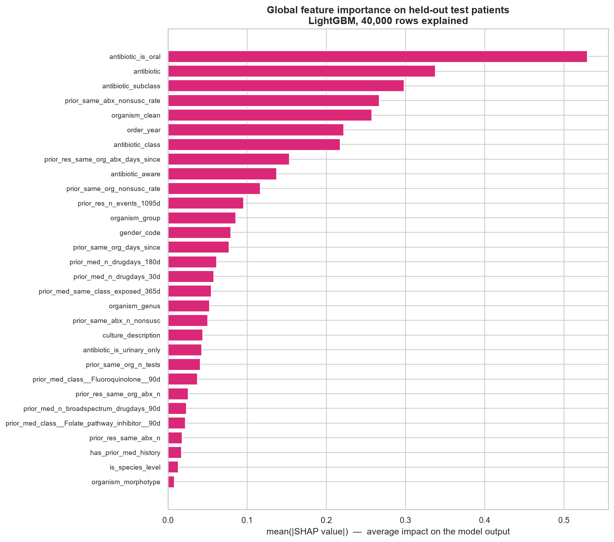
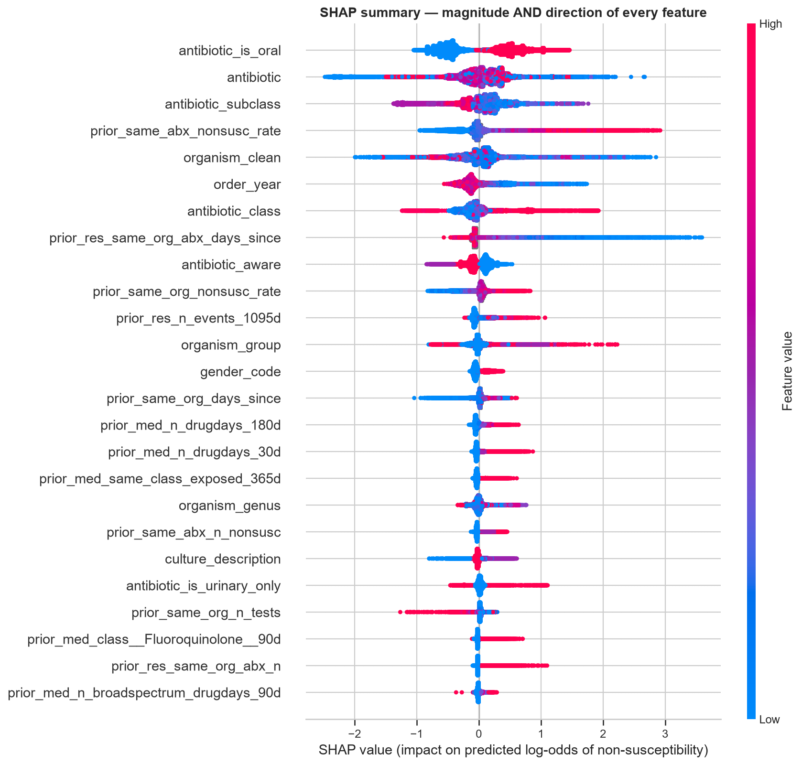
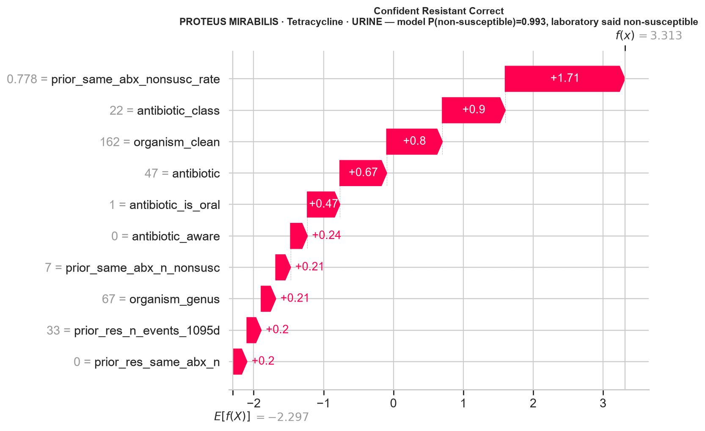
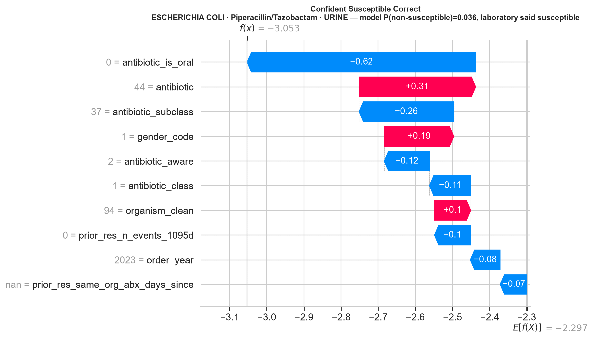
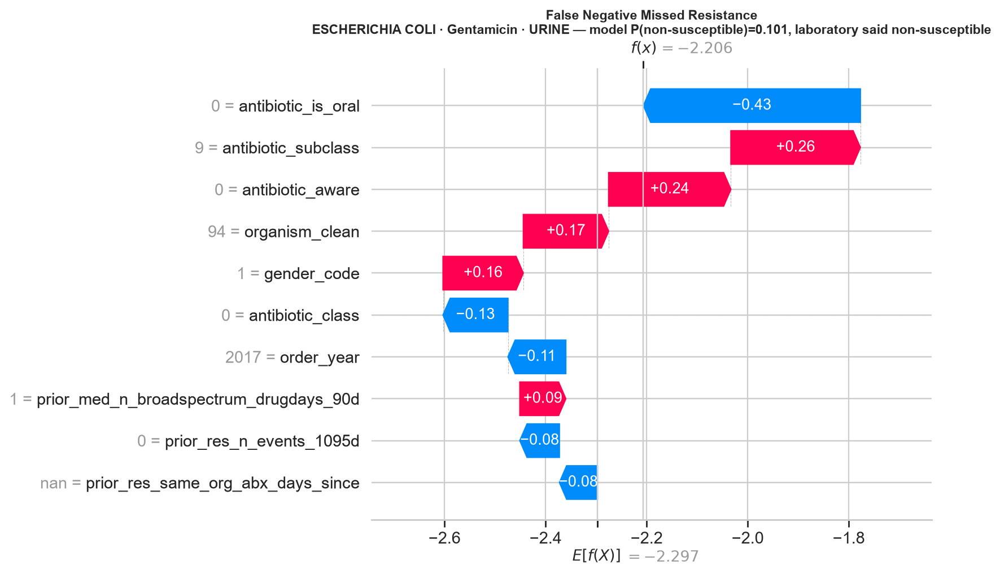
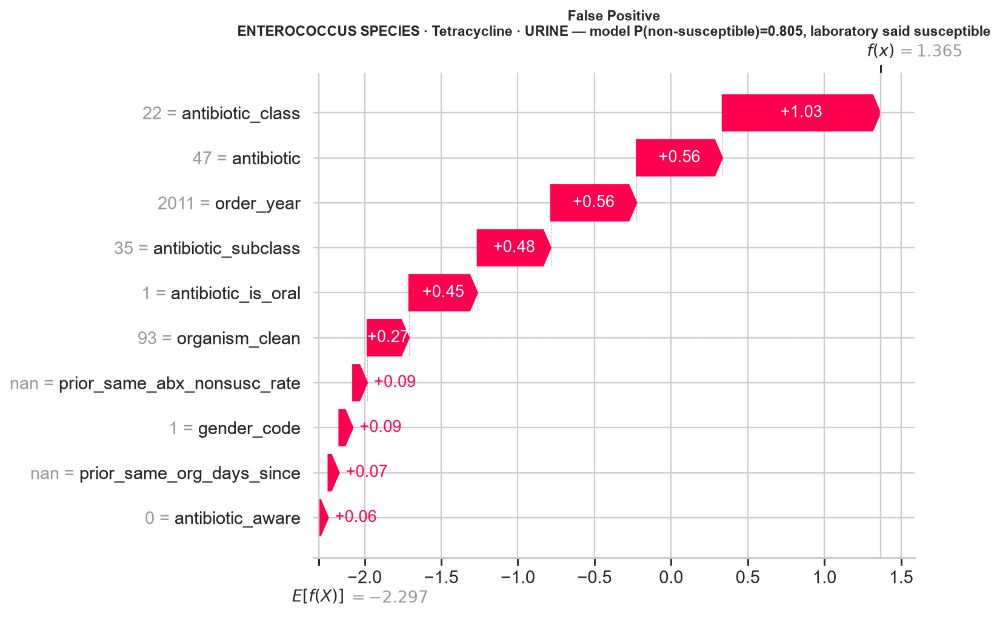
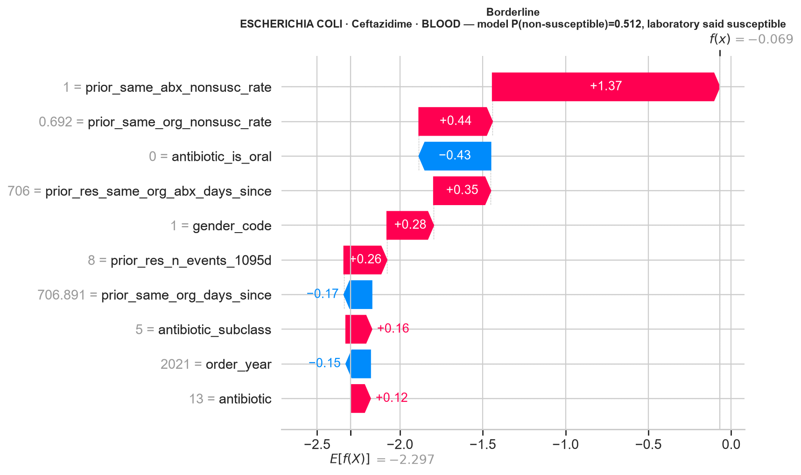

# Explainable AI Report

> Auto-generated by `scripts/11_generate_model_docs.py` from `07_EXPLAINABLE_AI/xai_report.json`.

## 1. Method

`shap.TreeExplainer` computes exact Shapley values for the deployed gradient-boosted model, so no sampling approximation is involved. Three properties make it the right choice here:

- **Local faithfulness** — a clinician needs to know why *this* isolate got *this* number, which split-gain importance cannot answer.
- **Additivity** — the contributions for one prediction sum exactly to the gap between that prediction and the model's base rate, which makes an explanation auditable.
- **Consistency** — if the model changes so a feature matters more, its attribution cannot fall. Impurity importance offers no such guarantee.

Base value (model log-odds at the population rate): **-2.297394**. 40,000 held-out test rows explained.

**What SHAP does not give.** A SHAP value attributes the MODEL's output, not causation in the patient. "Prior fluoroquinolone exposure raised the predicted resistance" means the estimate moved; it does not establish that the exposure caused the resistance. Every user-facing string in the application is worded accordingly.

## 2. Global feature importance

| Rank | Feature | mean(\|SHAP\|) |
|--:|---|--:|
| 1 | `antibiotic_is_oral` | 0.52967445 |
| 2 | `antibiotic` | 0.33770822 |
| 3 | `antibiotic_subclass` | 0.2982717 |
| 4 | `prior_same_abx_nonsusc_rate` | 0.26677113 |
| 5 | `organism_clean` | 0.25742681 |
| 6 | `order_year` | 0.22188414 |
| 7 | `antibiotic_class` | 0.217258 |
| 8 | `prior_res_same_org_abx_days_since` | 0.15343892 |
| 9 | `antibiotic_aware` | 0.13709723 |
| 10 | `prior_same_org_nonsusc_rate` | 0.1167494 |
| 11 | `prior_res_n_events_1095d` | 0.09542778 |
| 12 | `organism_group` | 0.08542477 |
| 13 | `gender_code` | 0.07913669 |
| 14 | `prior_same_org_days_since` | 0.07727455 |
| 15 | `prior_med_n_drugdays_180d` | 0.06140284 |
| 16 | `prior_med_n_drugdays_30d` | 0.0576515 |
| 17 | `prior_med_same_class_exposed_365d` | 0.05451192 |
| 18 | `organism_genus` | 0.05239814 |
| 19 | `prior_same_abx_n_nonsusc` | 0.05034242 |
| 20 | `culture_description` | 0.04376638 |
| 21 | `antibiotic_is_urinary_only` | 0.04268945 |
| 22 | `prior_same_org_n_tests` | 0.04067379 |
| 23 | `prior_med_class__Fluoroquinolone__90d` | 0.03700322 |
| 24 | `prior_res_same_org_abx_n` | 0.02553162 |
| 25 | `prior_med_n_broadspectrum_drugdays_90d` | 0.02349379 |

The beeswarm plot is the more informative of the two: it shows direction as well as magnitude, so a feature whose high values push towards resistance is visibly distinguishable from one whose high values push the other way.

## 3. Do the history features behave the way clinicians expect?

> A positive correlation between a prior-resistance feature's value and its SHAP contribution means the model raises predicted resistance as that history grows - the clinically expected direction. `days_since` features should correlate NEGATIVELY: the longer ago the prior event, the less it should push towards resistance.

| Feature | corr(value, SHAP) | Expected | n | Verdict |
|---|--:|:-:|--:|---|
| `prior_same_abx_nonsusc_rate` | +0.9596 | positive | 15,425 | as expected |
| `prior_res_same_abx_n` | -0.5929 | positive | 40,000 | **contradicts — investigated below** |
| `prior_res_same_org_abx_n` | +0.8556 | positive | 40,000 | as expected |
| `prior_res_same_org_abx_days_since` | -0.7604 | negative | 2,167 | as expected |
| `prior_res_n_events_1095d` | +0.5346 | positive | 40,000 | as expected |
| `prior_same_org_nonsusc_rate` | +0.9073 | positive | 12,842 | as expected |

This is a mechanism check, not a performance metric. A model can score well while having learned a shortcut, so the direction of the strongest history features is verified rather than assumed.

> A contradicting SHAP sign is a prompt to investigate, not a verdict. Two causes look identical in the SHAP column and are distinguished by the extra fields recorded here. (1) The model learned a shortcut - in which case the feature's RAW marginal association with the outcome will also be inverted or absent, and the finding is serious. (2) A strongly correlated partner feature already carries the signal and this one is absorbing a compensating correction - in which case the raw association is still in the clinically expected direction and the correlated partner is listed. SHAP splits credit between collinear features arbitrarily, so this is expected behaviour rather than a defect, but it does mean an individual attribution for one member of a correlated group should not be read in isolation.

### Investigating `prior_res_same_abx_n`

**Raw marginal association (model-independent):**

| | Value |
|---|--:|
| Non-susceptibility rate when the feature is 0 | 0.1659 |
| Non-susceptibility rate when the feature is > 0 | 0.5133 |
| Mean value among non-susceptible rows | 1.0954 |
| Mean value among susceptible rows | 0.1631 |

The raw association is in the **clinically expected direction** — the feature on its own predicts more resistance, by a wide margin. So the model has not learned an inverted relationship.

**Correlated partners in the selected feature set:**

| Partner feature | Pearson r |
|---|--:|
| `prior_res_same_org_abx_n` | +0.8457 |
| `prior_same_abx_n_nonsusc` | +0.7170 |

These partners carry the same clinical signal and all receive strongly positive SHAP attributions. Once they are in the model, the residual role of this feature is a **correction** rather than the primary signal, and SHAP assigns it a compensating negative contribution. This is credit-splitting between collinear features — expected behaviour, not a defect.

The practical consequence, and it is a real limitation: **an individual SHAP attribution for one member of a correlated group should not be read in isolation.** The application therefore shows the top contributions together rather than quoting a single one, and the correlation filter (|rho| > 0.95) was deliberately not tightened further, because removing one of each moderately-correlated pair would have cost predictive performance to buy tidier attributions.

## 4. Individual prediction explanations

Five cases were drawn from the held-out test partition — two the model got confidently right, two it got wrong, and one on the decision boundary. The failures are included deliberately: an explanation method is only useful if it also explains mistakes.

### Confident Resistant Correct

**PROTEUS MIRABILIS** · Tetracycline · URINE  

Model P(non-susceptible) = **0.99339**; the laboratory reported **non-susceptible**.

| Feature | Encoded value | SHAP contribution | Direction |
|---|--:|--:|---|
| `prior_same_abx_nonsusc_rate` | 0.7777777910232544 | +1.7121 | increases predicted resistance |
| `antibiotic_class` | 22.0 | +0.9002 | increases predicted resistance |
| `organism_clean` | 162.0 | +0.7968 | increases predicted resistance |
| `antibiotic` | 47.0 | +0.6697 | increases predicted resistance |
| `antibiotic_is_oral` | 1.0 | +0.4657 | increases predicted resistance |
| `antibiotic_aware` | 0.0 | +0.2408 | increases predicted resistance |
| `prior_same_abx_n_nonsusc` | 7.0 | +0.2115 | increases predicted resistance |
| `organism_genus` | 67.0 | +0.2084 | increases predicted resistance |

Base value -2.2974 + contributions +5.6834 = model output 3.3860 (log-odds).

### Confident Susceptible Correct

**ESCHERICHIA COLI** · Piperacillin/Tazobactam · URINE  

Model P(non-susceptible) = **0.03612**; the laboratory reported **susceptible**.

| Feature | Encoded value | SHAP contribution | Direction |
|---|--:|--:|---|
| `antibiotic_is_oral` | 0.0 | -0.6152 | increases predicted susceptibility |
| `antibiotic` | 44.0 | +0.3142 | increases predicted resistance |
| `antibiotic_subclass` | 37.0 | -0.2555 | increases predicted susceptibility |
| `gender_code` | 1.0 | +0.1870 | increases predicted resistance |
| `antibiotic_aware` | 2.0 | -0.1214 | increases predicted susceptibility |
| `antibiotic_class` | 1.0 | -0.1111 | increases predicted susceptibility |
| `organism_clean` | 94.0 | +0.0975 | increases predicted resistance |
| `prior_res_n_events_1095d` | 0.0 | -0.0963 | increases predicted susceptibility |

Base value -2.2974 + contributions -0.9194 = model output -3.2168 (log-odds).

### False Negative Missed Resistance

**ESCHERICHIA COLI** · Gentamicin · URINE  

Model P(non-susceptible) = **0.10057**; the laboratory reported **non-susceptible**.

| Feature | Encoded value | SHAP contribution | Direction |
|---|--:|--:|---|
| `antibiotic_is_oral` | 0.0 | -0.4294 | increases predicted susceptibility |
| `antibiotic_subclass` | 9.0 | +0.2563 | increases predicted resistance |
| `antibiotic_aware` | 0.0 | +0.2420 | increases predicted resistance |
| `organism_clean` | 94.0 | +0.1689 | increases predicted resistance |
| `gender_code` | 1.0 | +0.1590 | increases predicted resistance |
| `antibiotic_class` | 0.0 | -0.1285 | increases predicted susceptibility |
| `order_year` | 2017.0 | -0.1146 | increases predicted susceptibility |
| `prior_med_n_broadspectrum_drugdays_90d` | 1.0 | +0.0911 | increases predicted resistance |

Base value -2.2974 + contributions +0.1148 = model output -2.1826 (log-odds).

### False Positive

**ENTEROCOCCUS SPECIES** · Tetracycline · URINE  

Model P(non-susceptible) = **0.80479**; the laboratory reported **susceptible**.

| Feature | Encoded value | SHAP contribution | Direction |
|---|--:|--:|---|
| `antibiotic_class` | 22.0 | +1.0310 | increases predicted resistance |
| `antibiotic` | 47.0 | +0.5598 | increases predicted resistance |
| `order_year` | 2011.0 | +0.5594 | increases predicted resistance |
| `antibiotic_subclass` | 35.0 | +0.4788 | increases predicted resistance |
| `antibiotic_is_oral` | 1.0 | +0.4464 | increases predicted resistance |
| `organism_clean` | 93.0 | +0.2720 | increases predicted resistance |
| `prior_same_abx_nonsusc_rate` | None | +0.0944 | increases predicted resistance |
| `gender_code` | 1.0 | +0.0897 | increases predicted resistance |

Base value -2.2974 + contributions +3.6340 = model output 1.3366 (log-odds).

### Borderline

**ESCHERICHIA COLI** · Ceftazidime · BLOOD  

Model P(non-susceptible) = **0.51203**; the laboratory reported **susceptible**.

| Feature | Encoded value | SHAP contribution | Direction |
|---|--:|--:|---|
| `prior_same_abx_nonsusc_rate` | 1.0 | +1.3727 | increases predicted resistance |
| `prior_same_org_nonsusc_rate` | 0.692307710647583 | +0.4437 | increases predicted resistance |
| `antibiotic_is_oral` | 0.0 | -0.4339 | increases predicted susceptibility |
| `prior_res_same_org_abx_days_since` | 706.0 | +0.3452 | increases predicted resistance |
| `gender_code` | 1.0 | +0.2818 | increases predicted resistance |
| `prior_res_n_events_1095d` | 8.0 | +0.2599 | increases predicted resistance |
| `prior_same_org_days_since` | 706.8909912109375 | -0.1687 | increases predicted susceptibility |
| `antibiotic_subclass` | 5.0 | +0.1568 | increases predicted resistance |

Base value -2.2974 + contributions +2.2418 = model output -0.0556 (log-odds).

## 5. What drives the prediction, by antibiotic class

The same model uses different evidence for different classes — which is exactly what a unified model with the antibiotic as a feature is supposed to do.

| Antibiotic class | Test rows | Top 5 features by mean\|SHAP\| |
|---|--:|---|
| Cephalosporin | 7,941 | `antibiotic_is_oral`, `antibiotic_subclass`, `antibiotic`, `organism_clean`, `order_year` |
| Aminoglycoside | 5,845 | `antibiotic`, `antibiotic_is_oral`, `prior_same_abx_nonsusc_rate`, `order_year`, `organism_clean` |
| Fluoroquinolone | 5,644 | `antibiotic_is_oral`, `prior_same_abx_nonsusc_rate`, `prior_res_same_org_abx_days_since`, `organism_clean`, `antibiotic_subclass` |
| Beta-lactam/inhibitor | 4,218 | `antibiotic_is_oral`, `antibiotic`, `antibiotic_subclass`, `prior_same_abx_nonsusc_rate`, `organism_clean` |
| Penicillin | 3,454 | `antibiotic_is_oral`, `antibiotic_class`, `organism_clean`, `prior_same_abx_nonsusc_rate`, `antibiotic` |
| Carbapenem | 3,429 | `antibiotic_subclass`, `antibiotic_is_oral`, `antibiotic`, `antibiotic_class`, `prior_same_abx_nonsusc_rate` |
| Folate pathway inhibitor | 2,615 | `antibiotic_is_oral`, `prior_same_abx_nonsusc_rate`, `organism_clean`, `antibiotic`, `order_year` |
| Nitrofuran | 2,203 | `antibiotic_is_oral`, `organism_clean`, `antibiotic_is_urinary_only`, `prior_same_abx_nonsusc_rate`, `order_year` |
| Tetracycline | 1,715 | `antibiotic_class`, `antibiotic_is_oral`, `prior_same_abx_nonsusc_rate`, `order_year`, `antibiotic` |
| Monobactam | 608 | `antibiotic`, `antibiotic_is_oral`, `prior_same_abx_nonsusc_rate`, `order_year`, `organism_clean` |
| Glycopeptide | 577 | `antibiotic`, `organism_clean`, `antibiotic_subclass`, `antibiotic_is_oral`, `order_year` |
| Macrolide | 518 | `antibiotic_is_oral`, `antibiotic_subclass`, `prior_same_abx_nonsusc_rate`, `prior_res_same_org_abx_days_since`, `organism_clean` |
| Lincosamide | 477 | `antibiotic_is_oral`, `prior_same_abx_nonsusc_rate`, `antibiotic`, `order_year`, `organism_clean` |
| Oxazolidinone | 406 | `antibiotic_class`, `antibiotic_aware`, `antibiotic_subclass`, `organism_clean`, `prior_same_abx_nonsusc_rate` |

## 6. How this reaches the clinician

The application's *Explanation* tab runs the same `src/explainability/shap_explainer.py` code on the live prediction and renders the top contributions in clinical language, so what selected a feature, what the report documents and what the clinician sees are all the same computation.
