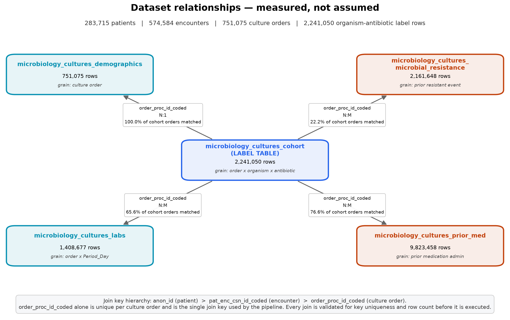

# Explainable Machine Learning for Antibiotic Resistance Prediction and Clinical Decision Support

> ⚠️ **Research prototype.** This system does not replace qualified healthcare professionals, antimicrobial susceptibility testing, clinical guidelines or professional medical judgement. It is not an autonomous prescribing system. See [Medical Safety Disclaimer](#medical-safety-disclaimer).

> Documentation in `docs/` is **generated from the pipeline's own output**, not written by hand, so every number below was measured. Regenerate with `python scripts/run_all.py --docs`.

## Overview

A machine-learning system that predicts, for an identified bacterial isolate, the probability that the laboratory would report it **non-susceptible** to each of 54 antibiotics — then explains that prediction, ranks the agents for clinician review, and requires a recorded human decision.

On a held-out test partition of 13,402 patients the model never saw: **PR-AUC 0.76166**, ROC-AUC 0.90189, sensitivity for non-susceptible 0.54543, specificity 0.96856 (no-skill PR-AUC baseline = prevalence = 0.1955).

## Problem statement

When a culture turns positive, the organism is identified roughly 24 hours before the antimicrobial susceptibility test (AST) result is reported. In that window a clinician must choose or continue therapy knowing *what* the organism is but not *what it is susceptible to*. Guess too narrow and the patient receives an ineffective antibiotic; guess too broad and the choice feeds the resistance that created the problem.

This project predicts the AST result from information that genuinely exists at that moment: the organism, the specimen, the patient's prior cultures, prior documented resistance and prior antibiotic exposure.

## Research gap

Published AMR-prediction work tends to share four weaknesses that this project addresses explicitly:

| Gap | What is usually done | What this project does |
|---|---|---|
| **Leakage is asserted, not demonstrated** | "We removed leaky features" | Every candidate is investigated with measured evidence and the verdict published, including the 21,879 rows where the resistance phenotype was hidden inside the organism *name*. See [`docs/DATA_LEAKAGE_ANALYSIS.md`](docs/DATA_LEAKAGE_ANALYSIS.md). |
| **Feature selection is a footnote** | Train on everything, or cite one importance plot | Seven methods, eight candidate feature sets, an organism-blind ablation, a feature-count sweep, and a nested-vs-global check quantifying how much the selection itself leaked. See [`04_FEATURE_SELECTION/FEATURE_SELECTION_REPORT.md`](04_FEATURE_SELECTION/FEATURE_SELECTION_REPORT.md). |
| **Random row splits inflate results** | `train_test_split` on rows | Patient-grouped splits (53.8% of patients have multiple cultures) **plus** a temporal holdout that trains on the past and tests on the future. |
| **Explanation stops at a global bar chart** | One feature-importance figure | Per-prediction SHAP shown in the application, failure cases explained alongside successes, and a mechanism check that the history features move the prediction in the clinically expected direction. |

## Objectives

1. Audit the real datasets exhaustively before writing a model.
2. Establish and document the true relational structure and every leakage pathway.
3. Define the prediction task the data actually supports.
4. Carry out feature selection as a first-class, comparable experiment.
5. Compare model families, resolve class imbalance empirically, and tune with grouped cross-validation.
6. Explain predictions individually as well as globally.
7. Rank antibiotics for clinician review with cited clinical guardrails, never as a prescription.
8. Integrate only real, verified external services for drug labelling and cost.
9. Keep the human clinician the decision-maker throughout.

## Dataset

Five linked de-identified tables from a single US academic health system, located at:

```
C:\Users\alanf\OneDrive\Desktop\Antibiotic Resistance Prediction and Clinical Decision Support
```

Raw files are **referenced in place and never modified**. Integrity is verifiable at any time with `python scripts/00_verify_raw_integrity.py`.

| File | Rows | Columns | Size | Contents |
|---|--:|--:|--:|---|
| `microbiology_cultures_cohort.csv` | 2,241,050 | 10 | 245 MB | Culture orders with organism, antibiotic and the susceptibility **label** |
| `microbiology_cultures_demographics.csv` | 751,075 | 5 | 33 MB | Age band and de-identified sex code, one row per culture order |
| `microbiology_cultures_labs.csv` | 1,408,677 | 59 | 428 MB | Laboratory aggregates over the 14 days before each culture |
| `microbiology_cultures_microbial_resistance.csv` | 2,161,648 | 7 | 201 MB | The patient's **prior** resistant results, with days before the index culture |
| `microbiology_cultures_prior_med.csv` | 9,823,458 | 7 | 802 MB | The patient's prior medication administrations, with days before the index culture |

**After cleaning:**

- 1,578,196 labelled (culture × organism × antibiotic) rows
- 118,749 positive culture orders from 67,008 patients
- 2007-10-09 → 2024-01-31
- **19.52% non-susceptible** (Resistant + Intermediate)
- 54 antibiotics, 245 cleaned organisms, 3 specimen types (urine, blood, respiratory)
- **No genomic data.** Confirmed column by column; the genomic module is implemented but inactive.

Full column-level documentation: [`docs/DATA_DICTIONARY.md`](docs/DATA_DICTIONARY.md).

## Dataset structure



Join key hierarchy: `anon_id` (patient) → `pat_enc_csn_id_coded` (encounter) → `order_proc_id_coded` (culture order). Only `demographics` is a true 1:1 companion; `labs`, `resistance` and `prior_med` are all one-to-many and are **aggregated to one row per key before joining**, never joined raw. Every merge in the pipeline runs through `validated_merge()`, which refuses to execute if the join would fan out or lose rows. Details: [`docs/DATA_RELATIONSHIPS.md`](docs/DATA_RELATIONSHIPS.md).

## Methodology

```text
Dataset
  ↓
Data Cleaning
  ↓
EDA
  ↓
Feature Engineering
  ↓
Feature Selection
  ↓
Model Training
  ↓
Model Comparison
  ↓
Best Model
  ↓
Explainable AI
  ↓
Resistance Prediction
  ↓
Antibiotic Ranking
  ↓
Clinician Review
```

## Exploratory data analysis

A 15-part EDA over the processed dataset produced 14 figures and 21 tables. It follows an explicit scope rule: structural description uses the full analytic dataset, while anything touching the TARGET uses the training partition only, so nothing seen while exploring can influence a decision that is later evaluated on validation or test data.

The findings that shaped the rest of the project:

- **The antibiotic panel is extremely ragged.** 16 of 54 agents have fewer than 1,000 rows, and the most-tested-to-least-tested ratio is 12,109:1. This is what makes a separate model per antibiotic untrainable.
- **The organism x antibiotic space is 78% empty** — only 21.6% of combinations have any test at all. Sharing structure through antibiotic class and organism group is a requirement, not an optimisation.
- **Patient history carries large univariate signal.** Prior resistance to the same organism-antibiotic pair raises the non-susceptibility rate from 16.4% to 68.8% (4.198x relative risk) — measured before any model was fitted.
- **The antibiogram reproduces textbook intrinsic resistance** at or near 1.00 (Klebsiella with ampicillin, Proteus with nitrofurantoin, AmpC organisms with cefazolin, S. aureus with penicillin), which independently validates the cleaning pipeline.
- **A source-data defect was found:** 6 `first_*` / `last_*` laboratory columns hold byte-identical values under different analyte names. They were already excluded by the missingness filter, so no corrupted value reached the model, but the defect is now on record.
- **Missingness is structural, not random** — a lab is missing because it was not ordered — so the tree models receive NaN directly rather than an imputed value.

Full report: [`02_DATA_ANALYSIS/EDA_REPORT.md`](02_DATA_ANALYSIS/EDA_REPORT.md) · figures in `02_DATA_ANALYSIS/figures/` · notebook at `02_DATA_ANALYSIS/notebooks/03_exploratory_data_analysis.ipynb`

## Machine learning models

Six families compared on identical training rows and identical held-out validation patients:

| Model | PR-AUC | ROC-AUC | F1 | Sensitivity | Specificity | Train (s) |
|---|--:|--:|--:|--:|--:|--:|
| LightGBM | 0.7641 | 0.8998 | 0.6461 | 0.7820 | 0.8448 | 5 |
| XGBoost | 0.7634 | 0.8982 | 0.6477 | 0.7732 | 0.8507 | 12 |
| HistGradientBoosting | 0.7607 | 0.8989 | 0.6446 | 0.7816 | 0.8436 | 12 |
| RandomForest | 0.7364 | 0.8925 | 0.6372 | 0.7785 | 0.8384 | 42 |
| LogisticRegression | 0.6099 | 0.8408 | 0.5598 | 0.7303 | 0.7864 | 10 |
| LinearSVM_SGD | 0.4506 | 0.7772 | 0.4929 | 0.6986 | 0.7239 | 8 |

**Architecture decision.** One unified model with the antibiotic as a feature, rather than 54 separate models or a multi-label model. The panel is extremely ragged (Ciprofloxacin has 111,321 rows; Cefpodoxime has 9), so separate models are untrainable for most agents and a multi-label target would be ~76% missing by construction. The choice is tested empirically in [`docs/MODEL_EVALUATION.md`](docs/MODEL_EVALUATION.md) §11.

**Class imbalance.** Positive rate 19.60%. Four strategies compared; **none (baseline)** selected. SMOTE was tested and *measurably harmed* performance — interpolating between ordinal-coded organism and antibiotic codes manufactures entities that do not exist.

## Feature selection

185 candidate features reduced to **30** through seven methods:

| # | Method | Effect |
|--:|---|---|
| 1 | Missing-value analysis (>95%) | 16 removed |
| 2 | Low-variance / near-constant (>99.9% dominant) | 1 removed |
| 3 | Correlation filter (\|rho\| > 0.95) | 35 removed from 57 redundant pairs |
| 4 | ANOVA F + mutual information | ranking (chi-square deliberately not used — the assumptions do not hold here) |
| 5 | Random Forest + XGBoost importance | ranking |
| 6 | SHAP | ranking, and the selection arbiter |
| 7 | Recursive feature elimination | 30 selected |

Candidate sets compared on held-out validation patients:

| Feature set | # | PR-AUC | ROC-AUC | F1 |
|---|--:|--:|--:|--:|
| **C_model_based_XGB_top30** | 30 | **0.7615** | 0.8985 | 0.6454 |
| G_rfe_selected | 30 | 0.7594 | 0.8976 | 0.6446 |
| D_consensus_final | 31 | 0.7567 | 0.8957 | 0.6457 |
| F_shap_top30 | 30 | 0.7513 | 0.8946 | 0.6484 |
| E_filters_only | 133 | 0.7483 | 0.8943 | 0.6500 |
| A_all_features | 185 | 0.7480 | 0.8946 | 0.6488 |
| B_statistical_MI_top30 | 30 | 0.7309 | 0.8833 | 0.6299 |
| H_organism_blind | 26 | 0.6548 | 0.8541 | 0.5778 |

Three results worth carrying into the report:

- **Fewer features win.** 30 features beat all 185 (0.7615 vs 0.7480) and train 2.6× faster.
- **The organism carries a large share of the signal.** Blinding the model to it drops PR-AUC to 0.6548 (-14%), which quantifies what a purely empiric, pre-identification model would lose.
- **Selecting on the full training set leaked almost nothing.** Re-deriving the selection inside every CV fold scores 0.75861 against 0.75963 for the global list — an optimism of +0.00102 PR-AUC, smaller than the fold-to-fold spread.

Full report: [`04_FEATURE_SELECTION/FEATURE_SELECTION_REPORT.md`](04_FEATURE_SELECTION/FEATURE_SELECTION_REPORT.md) · final set: [`docs/FINAL_FEATURE_SET.md`](docs/FINAL_FEATURE_SET.md)

## Explainable AI

SHAP (`TreeExplainer`, exact Shapley values) is used for global importance, per-prediction explanation and — critically — for explaining the model's *mistakes* as well as its successes.

Top drivers on held-out test patients: `antibiotic_is_oral`, `antibiotic`, `antibiotic_subclass`, `prior_same_abx_nonsusc_rate`, `organism_clean`, `order_year`, `antibiotic_class`, `prior_res_same_org_abx_days_since`.

A mechanism check confirms the history features move the prediction in the clinically expected direction — prior resistance pushes towards resistance, and the effect decays with time since the event. A model can score well while having learned a shortcut, so this is checked rather than assumed.

Report: [`07_EXPLAINABLE_AI/XAI_REPORT.md`](07_EXPLAINABLE_AI/XAI_REPORT.md)

## Recommendation engine

Model probabilities alone are not a recommendation, so three layers sit around them — as **flags on a visible option**, never as silent filters, and never as adjustments to the probability:

| Layer | What it catches | Source |
|---|---|---|
| Intrinsic resistance | *Enterococcus* + cephalosporin, *Klebsiella* + ampicillin, *Stenotrophomonas* + carbapenem … | EUCAST Expected Resistant Phenotypes v1.2; CLSI M100 |
| Site suitability | Nitrofurantoin for bacteraemia; daptomycin for pneumonia (surfactant inactivation) | FDA labelling; PK/PD |
| Evidence strength | How many training examples exist for this exact organism–antibiotic pair | Training-data coverage |
| Stewardship | WHO AWaRe Access / Watch / Reserve tier | WHO AWaRe 2023 |
| Allergy | Clinician-entered; cross-reactivity graded, not blanket | Clinician input |

Output is always framed as *"potentially suitable options for clinician review"*. A test asserts that no prescriptive phrasing appears anywhere in the ranking module.

## Application

Streamlit, one isolate at a time, nine tabs: **Dashboard · Prediction · Explanation · Options for review · Dosage reference · Cost · Patient history · Genomic · Clinician review**, plus Model Card and Data & Methodology pages.

- Cases can be **loaded from the held-out test partition**, so the prototype demonstrates on genuine patients and the true laboratory result is shown next to the prediction.
- Fields the clinician does not supply are filled with a training-set default **and listed on screen** as assumed.
- **Dosage** is the FDA label's `dosage_and_administration` section quoted verbatim via the openFDA API. The system never computes a dose; where patient data is insufficient it says *"Insufficient information for dosage reference."*
- **Cost** comes from live CMS NADAC records with NDC, effective date and retrieval timestamp; otherwise *"Price unavailable — verify locally."*
- **Genomic** tab reports honestly that no genomic data exists in these datasets, and shows the annotation format the module would produce if a genotype table were supplied.

### External services (all verified live)

| Service | Endpoint | Auth | Used for |
|---|---|---|---|
| openFDA drug label | `api.fda.gov/drug/label.json` | optional key | Verbatim dosage, warnings, contraindications |
| RxNorm / RxNav | `rxnav.nlm.nih.gov/REST` | none | Drug-name normalisation |
| CMS NADAC | `data.medicaid.gov/api/1/datastore/query/…` | none | Unit acquisition cost |

The retired RxNav **Drug Interaction API** is deliberately *not* integrated: it was verified to return "Not found" for valid RxCUIs, so the application shows no interaction data rather than data from an unmaintained source. Keys live in `.env` only; a test asserts none is hard-coded, and `ENABLE_LIVE_API=0` runs the whole application offline with graceful degradation.

## Installation

```bash
git clone <this repository>
cd Antibiotic-Resistance-AI

python -m venv .venv
.venv\Scripts\activate          # Windows
# source .venv/bin/activate      # macOS / Linux

pip install -r requirements.txt
copy .env.example .env           # then edit if you have API keys
```

Point `RAW_DATA_DIR` in `config/paths.py` at the source directory if the data is not at:

```
C:\Users\alanf\OneDrive\Desktop\Antibiotic Resistance Prediction and Clinical Decision Support
```

## Running the project

```bash
# Whole pipeline, in order (several hours on a laptop)
python scripts/run_all.py

# Or stage by stage
python scripts/00_verify_raw_integrity.py
python scripts/01_dataset_audit.py
python scripts/02_relationship_and_leakage_analysis.py
python scripts/03_generate_data_docs.py
python scripts/04_build_analytic_dataset.py
python scripts/05_generate_analysis_docs.py
python scripts/06_feature_selection.py
python scripts/07_train_models.py
python scripts/08_evaluate_models.py
python scripts/09_explainability.py
python scripts/10_generate_feature_docs.py
python scripts/11_generate_model_docs.py
python scripts/12_generate_project_docs.py

# Tests
python -m pytest 12_TESTS -q

# Application
streamlit run 11_APPLICATION/app.py
```

## Project structure

```text
Antibiotic-Resistance-AI/
├── 00_PROJECT_DOCUMENTATION/   overview, research gap, objectives
├── 01_DATA/                    raw (referenced) / interim / processed
├── 02_DATA_ANALYSIS/           audit + EDA notebooks and JSON reports
├── 03_FEATURE_ENGINEERING/     feature construction notebooks
├── 04_FEATURE_SELECTION/       7 methods, figures, FEATURE_SELECTION_REPORT.md
├── 05_MODEL_TRAINING/          models/, experiments/experiment_log.csv
├── 06_MODEL_EVALUATION/        figures, tables, MODEL_EVALUATION_REPORT.md
├── 07_EXPLAINABLE_AI/          SHAP figures, XAI_REPORT.md
├── 08_RECOMMENDATION_ENGINE/   ranking, rules, dosage, cost
├── 09_GENOMIC_AMR/             marker→mechanism module (inactive: no data)
├── 10_API_SERVICES/            openFDA, RxNav, CMS NADAC clients
├── 11_APPLICATION/             Streamlit app, pages, components
├── 12_TESTS/                   pytest suite
├── 13_RESULTS/                 figures, tables, predictions
├── 14_REPORT_MATERIAL/         report-ready copies of every figure/table
├── config/                     paths.py, final_features.json
├── docs/                       generated documentation
├── scripts/                    the numbered pipeline
├── src/                        reusable library code
├── README.md  PROJECT_MEMORY.md  CHANGELOG.md  MODEL_CARD.md
```

## Results

### Final model, held-out test partition

| Metric | Value |
|---|--:|
| PR-AUC | 0.76166 |
| ROC-AUC | 0.90189 |
| Sensitivity (non-susceptible) | 0.54543 |
| Specificity | 0.96856 |
| Precision (PPV) | 0.8083 |
| NPV | 0.89762 |
| F1 | 0.65134 |
| Macro F1 | 0.79154 |
| Weighted F1 | 0.87692 |
| Accuracy | 0.88583 |
| Brier score | 0.085373 |

No-skill PR-AUC = prevalence = 0.1955. Accuracy is reported but never used for selection: predicting "susceptible" for everything would already score 0.8045.

**Temporal generalisation.** Trained on the earlier years and tested on the most recent: PR-AUC 0.68597 against 0.76166 on the random patient split — a drop of 0.0757. This is the deployment-realistic figure and is reported rather than hidden.

Full breakdown by antibiotic, organism and subgroup: [`docs/MODEL_EVALUATION.md`](docs/MODEL_EVALUATION.md).

## User acceptance testing

The completed application was acceptance-tested against 60 held-out cultures (1,003 agent-level comparisons), driven through Streamlit's own `AppTest` harness so that every tab of the real application was rendered and inspected. **Result: PASS** - 57/59 tests passed, 2 failed and were fixed, 0 outstanding. 0 crashes across 32 invalid-input tests.

Verified: the application never prescribes, never removes a flagged option, never fabricates a value, and requires an explicit human confirmation before a decision is recorded. In the incorrect-prediction test case the model was wrong on 6 of 8 agents and **every disagreement was displayed with a working SHAP explanation** - the application explains its failures as readily as its successes.

Two defects were found and fixed, both confined to the external-API name-resolution layer. **No model was retrained and no measured performance number changed** (regression suite: 111 passed, 0 failed (identical before and after the fixes)). The more serious, BUG-01, was a missing identity check that allowed openFDA to return another product's label: Doripenem displayed the dosing for an antiviral. Correct dosage references rose 39/54 to 47/54 and wrong-drug labels fell from 6 to 0.

Performance: 32.7s cold start, 0.066s to score all 54 agents, 3.61s for SHAP. SHAP is 98.3% of the per-case cost.

Full report: [`12_TESTS/USER_ACCEPTANCE_TEST_REPORT.md`](12_TESTS/USER_ACCEPTANCE_TEST_REPORT.md) - summary for the write-up: [`14_REPORT_MATERIAL/USER_TESTING_SUMMARY.md`](14_REPORT_MATERIAL/USER_TESTING_SUMMARY.md) - test-by-test table: [`14_REPORT_MATERIAL/tables/user_testing_summary.csv`](14_REPORT_MATERIAL/tables/user_testing_summary.csv).

## Limitations

1. **Single centre, single country.** Resistance epidemiology is intensely local; the model needs recalibration before use elsewhere.
2. **Three specimen types, adults only.** Urine, blood and respiratory; the youngest age band is 18–24.
3. **Panel-selection bias.** An isolate is labelled only for the agents the laboratory chose to test, so the model learns the pattern *conditional on being tested*.
4. **Laboratory categories, not clinical outcomes.** Breakpoints also changed across the 2007–2024 span.
5. **Partial history.** Prior resistance exists for 38% of orders and prior medications for 70%; care outside this health system is invisible.
6. **No genomic data**, no comorbidity, no weight, no severity score, no source-control information.
7. **De-identified sex** (0/1, no legend), so no sex-specific claim can be made or audited.
8. **Not prospectively validated.** No clinician has used this in a real decision, and no outcome study exists.

## Future work

- External validation on a second health system; recalibration rather than retraining, to test transportability.
- Activate the genomic module against a real AMRFinderPlus / ResFinder export — the plug-in point already exists.
- Extend to wound, tissue and device isolates.
- Model the panel-selection mechanism explicitly (a two-stage or missing-not-at-random formulation) instead of conditioning on it.
- Prospective silent-mode evaluation, comparing model ranking against the clinician's actual choice before any interface is shown.
- Time-aware retraining with drift monitoring on the temporal metric.

## Medical safety disclaimer

> **This application is a research/clinical decision-support prototype. It does not replace qualified healthcare professionals, antimicrobial susceptibility testing, clinical guidelines, or professional medical judgment. AI-generated predictions and recommendations must be reviewed by an appropriately qualified healthcare professional.**

The system has no mechanism to prescribe, order or administer anything, and must never be given one. It does not generate doses — it relays FDA label text verbatim. It does not present cost as a reason to choose an antibiotic. Every ranked option is labelled a *potential option for clinician review*, and the application requires an explicit, recorded human decision.

## Documentation index

**Start here**

- [Project status — every stage, its results and its limitations](docs/PROJECT_STATUS.md)
- [Project memory — read this first in a new session](PROJECT_MEMORY.md)
- [Project overview — the whole thing in one page](00_PROJECT_DOCUMENTATION/PROJECT_OVERVIEW.md)

**Motivation**

- [Research gap](00_PROJECT_DOCUMENTATION/RESEARCH_GAP.md)
- [Objectives](00_PROJECT_DOCUMENTATION/OBJECTIVES.md)

**Data**

- [Data dictionary](docs/DATA_DICTIONARY.md)
- [Dataset relationships](docs/DATA_RELATIONSHIPS.md)
- [Data leakage analysis](docs/DATA_LEAKAGE_ANALYSIS.md)
- [Exploratory data analysis](02_DATA_ANALYSIS/EDA_REPORT.md)
- [Raw data policy](01_DATA/raw/README.md)

**Modelling**

- [ML problem definition](docs/ML_PROBLEM_DEFINITION.md)
- [Feature selection report](04_FEATURE_SELECTION/FEATURE_SELECTION_REPORT.md)
- [Final feature set](docs/FINAL_FEATURE_SET.md)
- [Model evaluation](docs/MODEL_EVALUATION.md)
- [Explainable AI report](07_EXPLAINABLE_AI/XAI_REPORT.md)
- [Model card — intended use, limitations, bias](MODEL_CARD.md)

**Decision support and services**

- [Genomic AMR module (inactive — no genomic data)](09_GENOMIC_AMR/README.md)
- [External API services](10_API_SERVICES/README.md)

**Verification**

- [System verification report — 59 executed checks](docs/SYSTEM_VERIFICATION.md)

**Report material**

- [Report material index — every figure and table](14_REPORT_MATERIAL/INDEX.md)

**History**

- [Changelog](CHANGELOG.md)

## Authors

Alan Francis Joseph — design, implementation and analysis.

Built with Claude Code. Datasets are de-identified and used for academic research.
