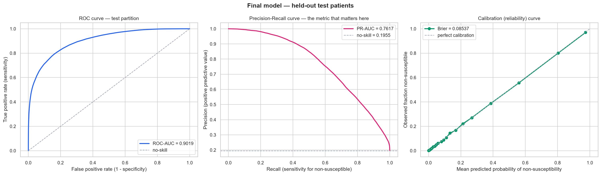
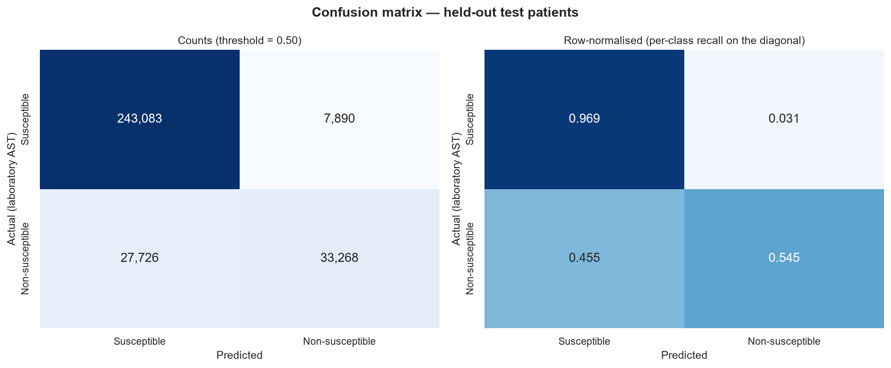
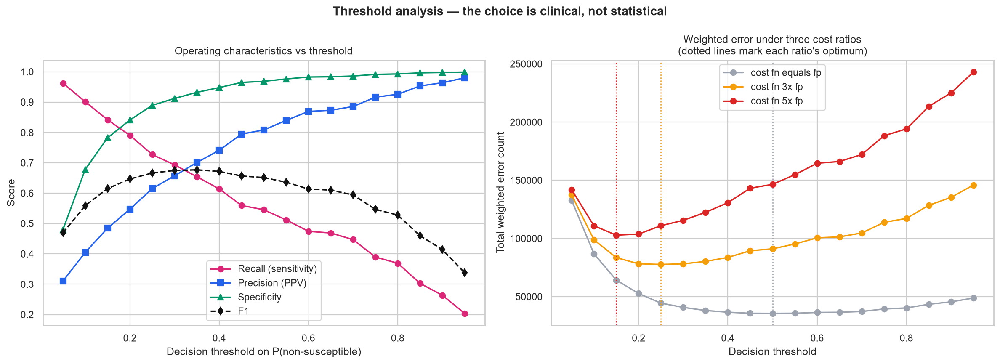
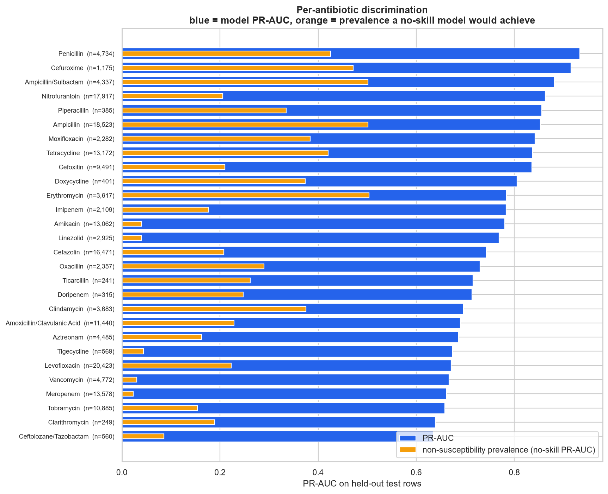
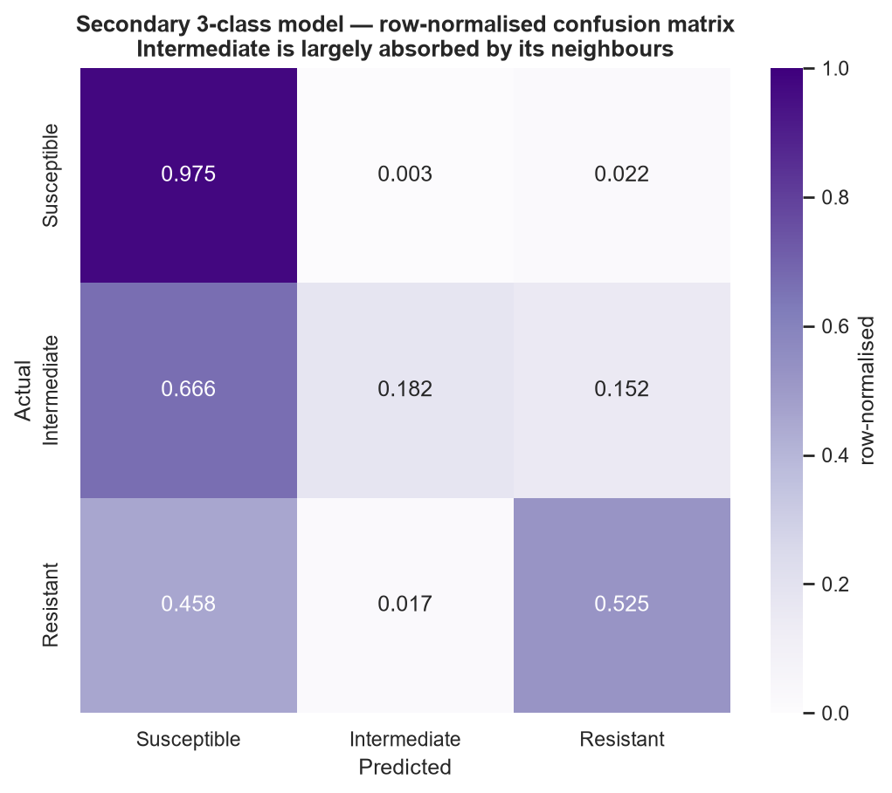
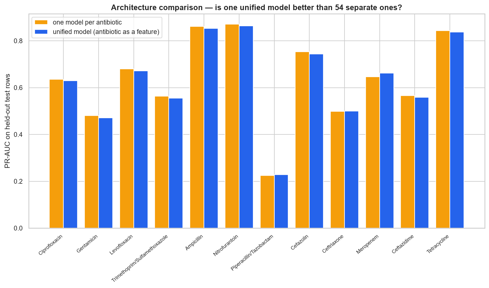

# Model Evaluation

> Auto-generated by `scripts/11_generate_model_docs.py` from `06_MODEL_EVALUATION/evaluation_report.json` and `05_MODEL_TRAINING/experiments/training_report.json`.

> The test partition was read exactly once, by `scripts/08_evaluate_models.py`. Nothing in feature selection, model selection, tuning or calibration touched it.

## 1. Data partitions

| Partition | Rows | Patients | Culture orders | Non-susceptible rate | Date range |
|---|--:|--:|--:|--:|---|
| train | 1,111,803 | 46,905 | 83,576 | 19.50% | 2007-10-09 → 2024-01-31 |
| val | 154,426 | 6,701 | 11,620 | 19.55% | 2008-02-03 → 2024-01-22 |
| test | 311,967 | 13,402 | 23,553 | 19.55% | 2008-01-20 → 2024-01-28 |

Splits are grouped on `anon_id`, so no patient appears in more than one partition. The near-identical positive rates across partitions confirm the grouped split did not distort the class balance.

## 2. Model family comparison

All six families were fitted on identical training rows with the identical 30-feature set and scored on the identical validation patients.

| Model | Accuracy | Precision | Recall | F1 | ROC-AUC | **PR-AUC** | Specificity | Brier | Training time (s) |
|---|--:|--:|--:|--:|--:|--:|--:|--:|--:|
| **LightGBM** | 0.8325 | 0.5504 | 0.7820 | 0.6461 | 0.8998 | **0.7641** | 0.8448 | 0.1169 | 5 |
| XGBoost | 0.8355 | 0.5573 | 0.7732 | 0.6477 | 0.8982 | 0.7634 | 0.8507 | 0.1151 | 12 |
| HistGradientBoosting | 0.8315 | 0.5485 | 0.7816 | 0.6446 | 0.8989 | 0.7607 | 0.8436 | 0.1187 | 12 |
| RandomForest | 0.8267 | 0.5393 | 0.7785 | 0.6372 | 0.8925 | 0.7364 | 0.8384 | 0.1245 | 42 |
| LogisticRegression | 0.7754 | 0.4539 | 0.7303 | 0.5598 | 0.8408 | 0.6099 | 0.7864 | 0.1594 | 10 |
| LinearSVM_SGD | 0.7190 | 0.3809 | 0.6986 | 0.4929 | 0.7772 | 0.4506 | 0.7239 | 0.2050 | 8 |

Why each family was included:

- **LightGBM** — Leaf-wise boosting; the fastest of the tree family at this scale and a useful check that the XGBoost result is not implementation-specific.
- **XGBoost** — Gradient boosting with native missing-value routing — important here because lab missingness is informative rather than random.
- **HistGradientBoosting** — scikit-learn's histogram gradient boosting. Included instead of the classic `GradientBoostingClassifier`, whose exact-split implementation would take hours on 1.1M rows for a strictly worse result.
- **RandomForest** — Bagged trees. Low variance, handles the mixed feature types, but cannot extrapolate and is memory-hungry at this row count.
- **LogisticRegression** — Interpretable linear baseline. Establishes how much of the signal is additive before any interaction is modelled.
- **LinearSVM_SGD** — Margin-based model at a tractable cost. `modified_huber` loss gives calibrated-ish probabilities directly, avoiding a second calibration wrapper.

The gap between the linear baseline (PR-AUC 0.6099) and the boosted trees (0.7641) is the clearest single result in the comparison: roughly a quarter of the achievable signal lives in interactions between the antibiotic, the organism and the patient's history, and an additive model cannot reach it.

## 3. Class imbalance — resolved by experiment, not by reflex

Positive-class prevalence is **19.60%**. Four strategies were compared on identical validation patients.

| Strategy | Training rows | **PR-AUC** | ROC-AUC | Recall | Precision | F1 | Brier |
|---|--:|--:|--:|--:|--:|--:|--:|
| **none (baseline)** | 499,817 | **0.7652** | 0.9003 | 0.5305 | 0.8235 | 0.6453 | 0.0856 |
| scale_pos_weight | 499,817 | 0.7621 | 0.8989 | 0.7785 | 0.5508 | 0.6452 | 0.1174 |
| random undersampling | 195,906 | 0.7562 | 0.8987 | 0.7870 | 0.5393 | 0.6400 | 0.1215 |
| SMOTE (subsample) | 192,688 | 0.6765 | 0.8451 | 0.7018 | 0.4735 | 0.5655 | 0.1398 |

**Selected: none (baseline).**

> The positive class is 19.5% — imbalanced but not extreme, so the question is which correction actually helps rather than whether to apply one. Strategies were compared on identical held-out validation patients. SMOTE is included for completeness but is a poor fit for this feature space: interpolating between ordinal-coded categoricals synthesises organism and antibiotic codes that correspond to no real entity, and interpolating sparse prior-exposure counts invents patient histories. Random undersampling discards a large share of the majority class and with it the informative lab and history patterns that only appear in susceptible isolates.

Three things the table settles:

1. **SMOTE actively harms this problem** — PR-AUC 0.6765 against 0.7652 for doing nothing, a -11.6% loss. Interpolating between ordinal-coded organism and antibiotic codes manufactures entities that do not exist, and interpolating sparse prior-exposure counts invents patient histories. This is the empirical version of the argument against applying SMOTE by reflex.
2. **Re-weighting trades calibration for recall.** `scale_pos_weight` raises recall from 0.5305 to 0.7785 at a fixed 0.5 threshold, but Brier worsens from 0.0856 to 0.1174 and PR-AUC is unchanged within noise. It moves the operating point; it does not add information.
3. **The right answer was to leave the class distribution alone and move the threshold instead.** Ranking quality (PR-AUC, ROC-AUC) is what the application needs, because it shows calibrated probabilities and an ordering rather than a binary verdict. Section 6 reports the operating points.

## 4. Hyperparameter tuning

`RandomizedSearchCV`, 12 candidates, 3-fold `StratifiedGroupKFold` grouped on `anon_id`, scored by average precision.

| Model | Best CV PR-AUC | Validation PR-AUC | Search time (s) |
|---|--:|--:|--:|
| XGBoost | 0.76042 | 0.75963 | 112 |
| LightGBM | 0.76072 | 0.76077 | 226 |

**XGBoost best parameters**

```json
{
  "subsample": 0.8,
  "reg_lambda": 5.0,
  "n_estimators": 800,
  "min_child_weight": 5,
  "max_depth": 10,
  "learning_rate": 0.03,
  "gamma": 2.0,
  "colsample_bytree": 0.8
}
```

**LightGBM best parameters**

```json
{
  "subsample": 0.9,
  "reg_lambda": 1.5,
  "num_leaves": 127,
  "n_estimators": 300,
  "min_child_samples": 20,
  "learning_rate": 0.05,
  "colsample_bytree": 0.8
}
```

## 5. Final model on the held-out test partition

Algorithm: **LightGBM** · 30 features · 311,967 test rows from 13,402 unseen patients.

| Metric | Value | Reading |
|---|--:|---|
| PR-AUC | **0.76166** | No-skill baseline is the prevalence, 0.1955. 95% CI [0.75819, 0.7645]. |
| ROC-AUC | **0.90189** | 95% CI [0.90063, 0.90308]. |
| Sensitivity / recall (non-susceptible) | **0.54543** | Share of genuinely non-susceptible results the model catches. |
| Specificity | **0.96856** | Share of susceptible results correctly left alone. |
| Precision (PPV) | **0.8083** | When it says non-susceptible, how often it is right. |
| NPV | **0.89762** | When it says susceptible, how often it is right. |
| F1 | **0.65134** | Harmonic mean of precision and recall. |
| Macro F1 | **0.79154** | Unweighted mean across both classes. |
| Weighted F1 | **0.87692** | Prevalence-weighted. |
| Accuracy | **0.88583** | Predicting 'susceptible' for everything would score 0.8045, which is why accuracy is reported but never used for selection. |
| Brier score | **0.085373** | Calibration. Lower is better; matters because the application ranks by probability. |

**Confusion matrix at threshold 0.50**

| | Predicted susceptible | Predicted non-susceptible |
|---|--:|--:|
| **Actually susceptible** | 243,083 | 7,890 |
| **Actually non-susceptible** | 27,726 | 33,268 |

**Calibration.** Isotonic regression fitted on the validation partition improves the test Brier score from 0.085431 to 0.085373 while leaving ranking essentially unchanged (PR-AUC 0.76701 → 0.76166). Isotonic calibration was fitted on the validation partition, never on this test partition, so this comparison is honest.





## 6. Threshold analysis

The deployed threshold is **0.5**, but the choice is clinical rather than statistical, so alternatives are published:

- Maximum F1 at threshold **0.35** (F1 = 0.6769).
- If a missed non-susceptibility is judged three times as costly as a false alarm, the optimum moves to **0.25**, giving recall 0.7271 and specificity 0.8894.

> The deployed threshold stays at 0.50 because the application shows a calibrated probability and a ranking, not a binary verdict. These alternatives are reported so a deploying site can choose its own operating point against its own cost ratio.



## 7. Where the model works, and where it does not

Per-antibiotic performance on the test partition. Read `pr_auc` against `positive_rate`: an agent whose PR-AUC barely exceeds its prevalence is one where the model adds little over the base rate.

| Antibiotic | Test rows | Non-susceptible rate | PR-AUC | ROC-AUC | Sensitivity | Specificity |
|---|--:|--:|--:|--:|--:|--:|
| Penicillin | 4,734 | 42.52% | 0.9333 | 0.9588 | 0.9076 | 0.8978 |
| Cefuroxime | 1,175 | 47.15% | 0.9152 | 0.9144 | 0.7690 | 0.9146 |
| Ampicillin/Sulbactam | 4,337 | 50.17% | 0.8814 | 0.8629 | 0.6889 | 0.8922 |
| Nitrofurantoin | 17,917 | 20.59% | 0.8633 | 0.9325 | 0.8040 | 0.9598 |
| Piperacillin | 385 | 33.51% | 0.8557 | 0.9104 | 0.6744 | 0.9609 |
| Ampicillin | 18,523 | 50.17% | 0.8529 | 0.8371 | 0.6380 | 0.8381 |
| Moxifloxacin | 2,282 | 38.34% | 0.8422 | 0.9032 | 0.7600 | 0.8991 |
| Tetracycline | 13,172 | 42.05% | 0.8371 | 0.8606 | 0.6989 | 0.8775 |
| Cefoxitin | 9,491 | 20.98% | 0.8356 | 0.9030 | 0.6986 | 0.9689 |
| Doxycycline | 401 | 37.41% | 0.8057 | 0.8879 | 0.7800 | 0.8127 |
| Erythromycin | 3,617 | 50.37% | 0.7838 | 0.7651 | 0.5598 | 0.8095 |
| Imipenem | 2,109 | 17.64% | 0.7835 | 0.9386 | 0.6801 | 0.9465 |
| Amikacin | 13,062 | 4.04% | 0.7805 | 0.9700 | 0.6774 | 0.9928 |
| Linezolid | 2,925 | 3.97% | 0.7690 | 0.9708 | 0.7328 | 0.9897 |
| Cefazolin | 16,471 | 20.76% | 0.7432 | 0.8459 | 0.5272 | 0.9826 |
| Oxacillin | 2,357 | 28.93% | 0.7299 | 0.8461 | 0.5147 | 0.9319 |
| Ticarcillin | 241 | 26.14% | 0.7156 | 0.8469 | 0.5238 | 0.9438 |
| Doripenem | 315 | 24.76% | 0.7134 | 0.8987 | 0.7564 | 0.8861 |
| Clindamycin | 3,683 | 37.50% | 0.6963 | 0.7631 | 0.3802 | 0.9418 |
| Amoxicillin/Clavulanic Acid | 11,440 | 22.88% | 0.6896 | 0.8137 | 0.4316 | 0.9806 |
| Aztreonam | 4,485 | 16.28% | 0.6864 | 0.8643 | 0.5247 | 0.9643 |
| Tigecycline | 569 | 4.39% | 0.6738 | 0.9494 | 0.2800 | 0.9982 |
| Levofloxacin | 20,423 | 22.28% | 0.6712 | 0.8326 | 0.4469 | 0.9686 |
| Vancomycin | 4,772 | 3.00% | 0.6667 | 0.9781 | 0.5175 | 0.9911 |
| Meropenem | 13,578 | 2.31% | 0.6616 | 0.9738 | 0.5382 | 0.9950 |
| Tobramycin | 10,885 | 15.39% | 0.6581 | 0.8539 | 0.4919 | 0.9790 |
| Clarithromycin | 249 | 18.88% | 0.6390 | 0.8670 | 0.3830 | 0.9654 |
| Ceftolozane/Tazobactam | 560 | 8.57% | 0.6344 | 0.9082 | 0.5417 | 0.9863 |
| Ciprofloxacin | 21,511 | 21.33% | 0.6299 | 0.8091 | 0.4132 | 0.9670 |
| Cefepime | 7,221 | 8.64% | 0.5970 | 0.8764 | 0.4167 | 0.9868 |
| Ceftazidime | 13,199 | 9.99% | 0.5583 | 0.8529 | 0.3905 | 0.9848 |
| Daptomycin | 1,093 | 2.29% | 0.5553 | 0.9679 | 0.2000 | 1.0000 |
| Trimethoprim/Sulfamethoxazole | 20,382 | 23.11% | 0.5545 | 0.7767 | 0.2883 | 0.9682 |
| Ceftriaxone | 14,228 | 11.64% | 0.4994 | 0.7905 | 0.3007 | 0.9897 |
| Gentamicin | 20,576 | 9.22% | 0.4708 | 0.7909 | 0.3047 | 0.9920 |
| Piperacillin/Tazobactam | 16,842 | 5.13% | 0.2286 | 0.7447 | 0.0949 | 0.9965 |
| Ceftazidime/Avibactam | 260 | 3.08% | 0.1656 | 0.8046 | 0.0000 | 0.9921 |
| Ertapenem | 11,401 | 0.48% | 0.1293 | 0.8585 | 0.0546 | 0.9996 |



### By organism

| Organism | Test rows | Non-susceptible rate | PR-AUC | ROC-AUC |
|---|--:|--:|--:|--:|
| ESCHERICHIA COLI | 172,672 | 17.03% | 0.6326 | 0.8639 |
| KLEBSIELLA PNEUMONIAE | 30,142 | 18.14% | 0.8544 | 0.9349 |
| STAPHYLOCOCCUS AUREUS | 18,291 | 24.77% | 0.8437 | 0.9379 |
| PSEUDOMONAS AERUGINOSA | 14,490 | 21.27% | 0.7202 | 0.8789 |
| PROTEUS MIRABILIS | 13,860 | 18.23% | 0.8809 | 0.9472 |
| ENTEROCOCCUS SPECIES | 12,860 | 22.66% | 0.7568 | 0.9109 |
| ENTEROBACTER CLOACAE | 5,703 | 29.90% | 0.9389 | 0.9607 |
| KLEBSIELLA OXYTOCA | 5,158 | 16.03% | 0.7780 | 0.9021 |
| KLEBSIELLA AEROGENES | 4,416 | 29.87% | 0.9491 | 0.9684 |
| COAGULASE NEGATIVE STAPHYLOCOCCUS | 4,254 | 44.41% | 0.8624 | 0.8929 |
| STREPTOCOCCUS AGALACTIAE | 4,035 | 20.00% | 0.6109 | 0.8867 |
| CITROBACTER KOSERI | 3,975 | 3.60% | 0.5045 | 0.8906 |
| CITROBACTER FREUNDII | 3,230 | 27.00% | 0.9142 | 0.9446 |
| SERRATIA MARCESCENS | 2,537 | 33.94% | 0.9595 | 0.9605 |
| MORGANELLA MORGANII | 1,875 | 40.05% | 0.9493 | 0.9564 |
| ENTEROCOCCUS FAECALIS | 1,847 | 13.43% | 0.8001 | 0.9586 |
| STREPTOCOCCUS PNEUMONIAE | 1,203 | 16.79% | 0.3876 | 0.7907 |
| PROTEUS VULGARIS | 767 | 28.55% | 0.9494 | 0.9686 |
| ACHROMOBACTER XYLOSOXIDANS | 721 | 64.77% | 0.9460 | 0.9182 |
| ENTEROCOCCUS FAECIUM | 578 | 51.56% | 0.8229 | 0.8446 |

## 8. Subgroup performance

### By `age` (PR-AUC spread 0.0616)

| Group | Rows | Non-susceptible rate | PR-AUC | ROC-AUC | Sensitivity | Specificity |
|---|--:|--:|--:|--:|--:|--:|
| 65-74 years | 57,512 | 20.27% | 0.7631 | 0.8998 | 0.5408 | 0.9688 |
| 75-84 years | 52,899 | 19.04% | 0.7634 | 0.9037 | 0.5388 | 0.9717 |
| 55-64 years | 48,284 | 22.53% | 0.7860 | 0.9019 | 0.5887 | 0.9595 |
| 45-54 years | 33,386 | 20.39% | 0.7594 | 0.8982 | 0.5442 | 0.9655 |
| 25-34 years | 33,280 | 17.40% | 0.7416 | 0.9069 | 0.5193 | 0.9713 |
| 35-44 years | 28,247 | 17.85% | 0.7244 | 0.8943 | 0.5027 | 0.9702 |
| 85-89 years | 20,624 | 19.44% | 0.7697 | 0.9016 | 0.5495 | 0.9720 |
| 18-24 years | 20,281 | 17.45% | 0.7602 | 0.9102 | 0.5396 | 0.9735 |
| above 90 | 17,454 | 18.33% | 0.7583 | 0.9042 | 0.5547 | 0.9700 |

### By `gender_code` (PR-AUC spread 0.0834)

| Group | Rows | Non-susceptible rate | PR-AUC | ROC-AUC | Sensitivity | Specificity |
|---|--:|--:|--:|--:|--:|--:|
| 0.0 | 231,046 | 17.96% | 0.7334 | 0.8960 | 0.5041 | 0.9726 |
| 1.0 | 80,906 | 24.09% | 0.8168 | 0.9133 | 0.6334 | 0.9560 |

### By `ordering_mode` (PR-AUC spread 0.0062)

| Group | Rows | Non-susceptible rate | PR-AUC | ROC-AUC | Sensitivity | Specificity |
|---|--:|--:|--:|--:|--:|--:|
| Inpatient | 160,407 | 21.19% | 0.7583 | 0.8939 | 0.5331 | 0.9654 |
| Outpatient | 139,818 | 17.84% | 0.7645 | 0.9092 | 0.5624 | 0.9710 |

### By `culture_description` (PR-AUC spread 0.1157)

| Group | Rows | Non-susceptible rate | PR-AUC | ROC-AUC | Sensitivity | Specificity |
|---|--:|--:|--:|--:|--:|--:|
| URINE | 245,900 | 17.88% | 0.7355 | 0.8953 | 0.5042 | 0.9737 |
| RESPIRATORY | 35,625 | 28.41% | 0.8511 | 0.9251 | 0.7090 | 0.9402 |
| BLOOD | 30,442 | 22.70% | 0.7742 | 0.9020 | 0.5681 | 0.9553 |

### By `organism_group` (PR-AUC spread 0.5266)

| Group | Rows | Non-susceptible rate | PR-AUC | ROC-AUC | Sensitivity | Specificity |
|---|--:|--:|--:|--:|--:|--:|
| GN_Enterobacterales | 247,112 | 18.09% | 0.7447 | 0.8958 | 0.5110 | 0.9745 |
| GP_Cocci | 45,285 | 24.99% | 0.8070 | 0.9225 | 0.6377 | 0.9482 |
| GN_NonFermenter | 17,606 | 23.53% | 0.7592 | 0.8872 | 0.6207 | 0.9447 |
| Mycobacterium | 1,036 | 53.09% | 0.8265 | 0.8357 | 0.8436 | 0.7119 |
| GP_Rod | 477 | 35.64% | 0.7743 | 0.8927 | 0.8176 | 0.8078 |
| Anaerobe | 291 | 12.37% | 0.2998 | 0.7983 | 0.0556 | 0.9804 |

PR-AUC is not directly comparable across groups with different prevalence, so each group's PR-AUC should be read against its own non-susceptible rate. ROC-AUC is prevalence-independent and is the fairer cross-group comparison.

## 9. Temporal generalisation

Trained on cultures up to 2022-02-19 and tested on 199,767 rows from 2022-02-19 onwards, with patients spanning the cut-off removed from the test side.

| | Patient-grouped split | Temporal split | Difference |
|---|--:|--:|--:|
| PR-AUC | 0.7617 | 0.6860 | -0.0757 |
| ROC-AUC | 0.9019 | 0.8859 | -0.0160 |
| Sensitivity | 0.5454 | 0.4023 | -0.1431 |
| Brier | 0.0854 | 0.0777 | -0.0077 |

> The temporal arm trains only on earlier cultures and is tested on the most recent ones, with patients who straddle the cut-off removed from the test side. It is the deployment-realistic number: resistance prevalence and prescribing both drift, so a model fitted on the past faces a shifted distribution. A drop here relative to the patient-grouped split is expected and is reported rather than hidden.

## 10. Secondary 3-class model

Accuracy 0.8776, macro F1 0.6109, weighted F1 0.8630 (599,992 training rows).

| Class | Precision | Recall | F1 | Support |
|---|--:|--:|--:|--:|
| Susceptible | 0.8915 | 0.9754 | 0.9316 | 250,973 |
| Intermediate | 0.4969 | 0.1822 | 0.2667 | 8,923 |
| Resistant | 0.8015 | 0.5251 | 0.6345 | 52,071 |

> The Intermediate class is the hard one, exactly as expected: it is defined by a narrow MIC band adjacent to the breakpoint and is the least reproducible AST category. Its recall is far below the other two classes. This is the empirical reason the primary task groups Intermediate with Resistant rather than trying to isolate it.



## 11. Architecture comparison — one unified model vs one per antibiotic

`docs/ML_PROBLEM_DEFINITION.md` argued for a single unified model with the antibiotic as a feature. Here is the test. For each of the 12 highest-volume agents, a dedicated single-agent model was trained on that agent's rows only and compared with the unified model's predictions on the identical test rows.

| Antibiotic | Train rows | Test rows | Non-susc. rate | Per-agent PR-AUC | Unified PR-AUC | Unified advantage |
|---|--:|--:|--:|--:|--:|--:|
| Ciprofloxacin | 76,823 | 21,511 | 21.33% | 0.6356 | 0.6299 | -0.0058 |
| Gentamicin | 73,346 | 20,576 | 9.22% | 0.4802 | 0.4708 | -0.0095 |
| Levofloxacin | 72,943 | 20,423 | 22.28% | 0.6805 | 0.6712 | -0.0093 |
| Trimethoprim/Sulfamethoxazole | 72,300 | 20,382 | 23.11% | 0.5639 | 0.5545 | -0.0094 |
| Ampicillin | 65,195 | 18,523 | 50.17% | 0.8615 | 0.8529 | -0.0085 |
| Nitrofurantoin | 62,932 | 17,917 | 20.59% | 0.8714 | 0.8633 | -0.0081 |
| Piperacillin/Tazobactam | 59,867 | 16,842 | 5.13% | 0.2245 | 0.2286 | +0.0041 |
| Cefazolin | 57,923 | 16,471 | 20.76% | 0.7533 | 0.7432 | -0.0101 |
| Ceftriaxone | 50,099 | 14,228 | 11.64% | 0.4990 | 0.4994 | +0.0004 |
| Meropenem | 48,532 | 13,578 | 2.31% | 0.6459 | 0.6616 | +0.0158 |
| Ceftazidime | 47,240 | 13,199 | 9.99% | 0.5661 | 0.5583 | -0.0079 |
| Tetracycline | 46,993 | 13,172 | 42.05% | 0.8437 | 0.8371 | -0.0065 |

**Result: the unified model wins on 3 of 12 agents, mean advantage -0.0046 PR-AUC.**

This is the honest answer, and it does not fully favour the architecture chosen in `docs/ML_PROBLEM_DEFINITION.md`. On the highest-volume agents a dedicated single-agent model is on average 0.0046 PR-AUC **better** than the unified model. That is what theory predicts: with tens of thousands of rows for one agent, a specialised model can fit that agent's own interactions without spending capacity on fifty-three others.

The unified architecture is still the right choice for this application, for reasons the table cannot show:

1. **The margin is small.** 0.0046 PR-AUC on the agents most favourable to the alternative.
2. **This comparison is restricted to agents with enough data to make it possible at all.** It required at least 20,000 training rows and 2,000 test rows per agent. Most of the 54 agents do not clear that bar — Cefpodoxime has 9 rows in total, Chloramphenicol 12, Meropenem/Vaborbactam 26. A dedicated model for those is not *worse*; it is untrainable. The unified model still scores them by borrowing from their class and the organism.
3. **The application needs to score every agent for a new isolate**, including agents the laboratory did not test. Fifty-four separately-versioned models, most fitted to a few hundred rows, is a worse system than one model with a shared representation.
4. **Maintenance.** One model to retrain, calibrate, explain and monitor rather than 54.

The trade-off is therefore stated explicitly rather than claimed away: the unified model gives up a small amount of accuracy on common agents in exchange for coverage of rare ones and a single maintainable artefact. A deployment that only ever needed the ten commonest agents should reconsider and use per-agent models.



## 12. Reproducibility

- Random seed `42` throughout: splitting, subsampling, model initialisation and the hyperparameter search.
- Every experiment is logged to `05_MODEL_TRAINING/experiments/experiment_log.csv`.
- Raw-data integrity is verifiable with `python scripts/00_verify_raw_integrity.py`.
- The full pipeline is re-runnable end to end with `python scripts/run_all.py`.
